# BẢN ĐỒ SOURCE CODE VÀ TRAINING PIPELINE (ECG PROJECT)

> **Mục tiêu tài liệu:** Cung cấp hướng dẫn trực quan, chi tiết và chính xác 100% dựa trên mã nguồn thực tế trong workspace `Denoise-Clasify_ECG`. Tài liệu được thiết kế dành riêng cho người mới học Deep Learning, giúp hiểu rõ đường đi của dữ liệu, cấu trúc các file, cơ chế hoạt động của 1D-CNN và cách cập nhật tham số khi huấn luyện.

---

## 1. TỔNG QUAN HỆ THỐNG VÀ PHÂN BIỆT HAI PIPELINE

Trong workspace hiện tại, dự án được chia thành **hai bài toán (pipeline) riêng biệt**. Việc phân biệt rõ hai pipeline này là tối quan trọng để không bị nhầm lẫn về dữ liệu và mục tiêu:

```mermaid
graph TD
    subgraph Pipeline_1 ["PIPELINE 1: ECG Classification (Phase 1 & 2) — ĐÃ CHẠY HOÀN CHỈNH"]
        P1_Data["MITDB Raw Records (MLII)"] --> P1_Filter["Butterworth Bandpass [0.5 - 60 Hz]"]
        P1_Filter --> P1_Seg["Cắt từng nhịp quanh R-peak (260 mẫu)"]
        P1_Seg --> P1_Norm["Per-beat Z-score Normalization"]
        P1_Norm --> P1_Split["Inter-patient Split (DS1 / DS2)"]
        P1_Split --> P1_NPZ["data/processed/{train,val,test}.npz"]
        P1_NPZ --> P1_Train["train_cnn1d.py (1D-CNN Baseline)"]
        P1_Train --> P1_Eval["evaluate_cnn1d.py -> results/cnn1d/"]
    end

    subgraph Pipeline_2 ["PIPELINE 2: ECG Denoising (Level 2) — MỚI XÂY DỰNG DATASET, CHƯA CÓ MODEL"]
        P2_Data["MITDB Clean + NSTDB Noise (bw, ma, em)"] --> P2_Filter["Butterworth Bandpass [0.05 - 60 Hz]"]
        P2_Filter --> P2_Win["Sliding Window 1024 mẫu (Không căn R-peak)"]
        P2_Win --> P2_Norm["Record Max-Abs Normalization (≤ 1.0)"]
        P2_Norm --> P2_Noise["Inject Noise theo SNR [-6 đến +24 dB]"]
        P2_Noise --> P2_Out["Processed/denoising_v1/"]
        P2_Out --> P2_Todo["Model & Training Denoising: CHƯA TRIỂN KHAI"]
    end
```



### So sánh bản chất hai pipeline:

| Tiêu chí | Pipeline 1: Phân loại nhịp tim (Classification) | Pipeline 2: Khử nhiễu dạng sóng (Denoising) |
|---|---|---|
| **Mục tiêu** | Dự đoán nhịp tim thuộc 1 trong 5 lớp AAMI (`N, S, V, F, Q`) | Khôi phục tín hiệu ECG sạch từ tín hiệu bị nhiễm nhiễu |
| **Tình trạng thực tế** | **ĐÃ HOÀN CHỈNH 100%**: Có dataset, model (MLP, 1D-CNN), file train, evaluate, checkpoint và kết quả | **MỚI XONG BƯỚC DATASET**: Đã tạo xong dữ liệu và kiểm thử, nhưng **chưa có code model và chưa có script training** |
| **Độ dài đầu vào** | **260 mẫu** (~0.72 giây tại 360 Hz) quanh đỉnh sóng R | **1024 mẫu** (~2.84 giây tại 360 Hz) trượt liên tục |
| **Căn chỉnh nhịp** | **Có**: Căn giữa theo đỉnh R (-99 mẫu trước R, +161 mẫu sau R) | **Không**: Cửa sổ trượt (sliding window, stride 512), không phụ thuộc đỉnh R |
| **Chuẩn hóa** | **Per-beat Z-score**: $(\text{beat} - \mu) / \sigma$ (ép mean=0, std=1 cho từng nhịp) | **Record Max-Abs**: chia cho giá trị tuyệt đối lớn nhất của cả bản ghi để bảo toàn tỷ lệ năng lượng |
| **Dải lọc tín hiệu** | $[0.5\text{ Hz}, 60\text{ Hz}]$ (loại bỏ hẳn baseline wander để dễ phân loại) | $[0.05\text{ Hz}, 60\text{ Hz}]$ (giữ lại dao động chậm để model học cách khử nhiễu) |

---

## 2. BẢN ĐỒ SOURCE CODE CHI TIẾT (FILE-BY-FILE MAP)

### 2.1 Sơ đồ luồng dữ liệu của Pipeline Classification (1D-CNN)

```
[WFDB Raw Files: .dat, .hea, .atr]
       │
       ▼ (src/data/mitdb_loader.py: load_record / iter_records)
[Raw Signal: (650000,) float64] + [Annotations: samples, symbols]
       │
       ▼ (src/data/preprocessing.py: preprocess_signal -> bandpass_butterworth)
[Filtered Signal: (650000,) float64]
       │
       ▼ (src/data/segmentation.py: segment_record)
[X: (N_beats, 260) float32] + [y: (N_beats,) int32]
       │
       ▼ (scripts/build_dataset.py: build_split -> save_split)
[Files: data/processed/train.npz, val.npz, test.npz]
       │
       ▼ (src/data/ecg_dataset.py: make_dataloader -> ECGClassificationDataset)
[Batch: X_batch (64, 1, 260) float32, y_batch (64,) int64]
       │
       ▼ (train_cnn1d.py -> src/models/cnn1d.py: CNN1DBaseline)
[Logits: (64, 5) float32] ──► [nn.CrossEntropyLoss] ──► [optimizer.step()]
       │
       ▼ (Lưu checkpoint khi val_macro_f1 cao nhất)
[File: checkpoints/cnn1d_best.pt]
       │
       ▼ (evaluate_cnn1d.py)
[Reports: results/cnn1d/test_metrics.json, test_metrics.csv, confusion_matrix.png]
```

---

### 2.2 Chi tiết từng file trong Pipeline Classification

#### 1. File cấu hình: `configs/dataset_config.yaml`
1. **Trách nhiệm:** Lưu trữ toàn bộ tham số cấu hình cho việc đọc dữ liệu, dải lọc, kích thước cửa sổ cắt nhịp, quy tắc phân lớp AAMI, danh sách bản ghi theo từng split bệnh nhân.
2. **Dữ liệu nhận vào:** Không nhận dữ liệu (file text YAML).
3. **Shape & dtype:** Không có.
4. **Dữ liệu trả về:** Dictionary Python khi được load bằng `yaml.safe_load()`.
5. **File tiếp theo sử dụng:** `scripts/build_dataset.py` đọc file này làm kim chỉ nam để sinh ra dataset.
6. **Tham số quan trọng:**
   - `signal.sampling_rate`: `360` (tần số lấy mẫu MITDB).
   - `window.size`: `260` (`before_r: 99`, `after_r: 161`).
   - `preprocessing.lowcut_hz`: `0.5`, `highcut_hz`: `60.0`, `butterworth_order`: `4`.
   - `splits.train_records`, `val_records`, `test_records`: Danh sách ID bản ghi phân chia theo giao thức liên bệnh nhân De Chazal.
7. **Yêu cầu khi thay đổi:** Bất kỳ thay đổi nào trong file này (đổi dải tần lọc, đổi window size, đổi phân chia split) **BẮT BUỘC PHẢI CHẠY LẠI** `scripts/build_dataset.py` để tạo lại dữ liệu.

---

#### 2. File đọc dữ liệu: `src/data/mitdb_loader.py`
1. **Trách nhiệm:** Sử dụng thư viện `wfdb` để đọc tín hiệu điện tâm đồ và file nhãn từ đĩa.
2. **Dữ liệu nhận vào:** `record_id` (số nguyên, ví dụ: 100), `channel_idx` (0 tương ứng lead MLII), đường dẫn `local_path`.
3. **Shape & dtype:**
   - Đầu vào: Đọc file nhị phân `.dat`, header `.hea`, nhãn `.atr`.
   - Đầu ra của hàm `load_record()`:
     - `signal`: `np.ndarray`, shape `(650000,)`, dtype `float64` (đã đổi sang mV vật lý).
     - `ann_samples`: `np.ndarray`, shape `(N_annotations,)`, dtype `int64` (vị trí mẫu của đỉnh R).
     - `ann_symbols`: `list[str]`, độ dài `N_annotations` (ký hiệu nhịp tim do bác sĩ gán, ví dụ: `'N'`, `'V'`, `'A'`).
4. **File tiếp theo sử dụng:** `scripts/build_dataset.py` gọi hàm `iter_records()` để lấy từng bản ghi và chuyển cho bước tiền xử lý.
5. **Tham số đọc từ:** `configs/dataset_config.yaml` (`database.local_path`, `signal.channel_index`).
6. **Yêu cầu khi thay đổi:** Nếu đổi kênh đo (channel) hoặc cách load, phải rebuild dataset.

---

#### 3. File tiền xử lý tín hiệu: `src/data/preprocessing.py`
1. **Trách nhiệm:** Thực hiện lọc dải thông (Bandpass filter) để loại bỏ nhiễu trôi đường nền (Baseline Wander < 0.5 Hz) và nhiễu nguồn điện lưới (Powerline Noise > 60 Hz). Ngoài ra cung cấp hàm chuẩn hóa Z-score per-beat.
2. **Dữ liệu nhận vào:** `signal`: mảng 1D ECG thô `(650000,)`, dtype `float64`.
3. **Shape & dtype:** Trả về mảng 1D `filtered`: shape `(650000,)`, dtype `float64`.
4. **Hàm cốt lõi:**
   - `bandpass_butterworth(signal, lowcut=0.5, highcut=60.0, fs=360.0, order=4)`: Sử dụng `scipy.signal.butter` và `scipy.signal.filtfilt`. Điểm mấu chốt là `filtfilt` chạy 2 chiều (forward-backward) giúp góc pha không bị dịch chuyển (zero-phase shift), giữ nguyên vị trí thời gian của các đỉnh sóng.
   - `zscore_normalize(window)`: $(x - \text{mean}) / (\text{std} + \epsilon)$ đưa cửa sổ về trung bình 0 và độ lệch chuẩn 1.
5. **File tiếp theo sử dụng:** Tín hiệu lọc được chuyển sang `src/data/segmentation.py`.
6. **Yêu cầu khi thay đổi:** Thay đổi tần số cắt hoặc bậc lọc yêu cầu rebuild dataset.

---

#### 4. File cắt nhịp và gán nhãn: `src/data/segmentation.py`
1. **Trách nhiệm:** Dựa vào vị trí đỉnh R trong file annotation, cắt cửa sổ xung quanh R-peak, lọc bỏ các ký hiệu không phải nhịp tim, ánh xạ về 5 nhóm AAMI, và chuẩn hóa Z-score từng nhịp.
2. **Dữ liệu nhận vào:** `signal` đã lọc `(650000,)`, `ann_samples`, `ann_symbols`, `record_id`.
3. **Shape & dtype:**
   - `X`: `np.ndarray`, shape `(N_beats, 260)`, dtype `np.float32`.
   - `y`: `np.ndarray`, shape `(N_beats,)`, dtype `np.int32` (giá trị thuộc `{0, 1, 2, 3, 4}`).
   - `meta`: dictionary chứa `record_ids` (mảng int32), `beat_indices` (mảng int64), `original_symbols` (list str).
4. **Quy tắc ánh xạ AAMI (`AAMI_MAP`):**
   - Lớp 0 (`N` - Bình thường): `N, L, R, e, j`
   - Lớp 1 (`S` - Ngoại tâm thu trên thất): `A, a, J, S`
   - Lớp 2 (`V` - Ngoại tâm thu thất): `V, E`
   - Lớp 3 (`F` - Nhịp kết hợp): `F`
   - Lớp 4 (`Q` - Không rõ / Khác): `/, f, Q`
5. **Xử lý biên (Boundary check):** Nếu `r_pos - 99 < 0` hoặc `r_pos + 161 > len(signal)`, nhịp đó bị bỏ qua để tránh lỗi tràn chỉ số.
6. **File tiếp theo sử dụng:** `scripts/build_dataset.py` nhận các mảng này để lưu thành file `.npz`.
7. **Yêu cầu khi thay đổi:** Rebuild dataset.

---

#### 5. File phân chia dữ liệu: `src/data/splits.py`
1. **Trách nhiệm:** Định nghĩa giao thức chia tập dữ liệu theo bệnh nhân (Inter-patient protocol De Chazal 2004). Ngăn chặn rò rỉ dữ liệu bằng cách đảm bảo nhịp tim của một bệnh nhân không bao giờ xuất hiện ở cả tập train và tập test.
2. **Phân chia cụ thể:**
   - **Tập Train (18 bản ghi):** `101, 106, 108, 109, 112, 114, 115, 116, 118, 119, 122, 124, 201, 205, 207, 208, 209, 215` (tổng cộng 41,116 nhịp).
   - **Tập Val (4 bản ghi):** `203, 220, 223, 230` (tổng cộng 9,885 nhịp).
   - **Tập Test (22 bản ghi - DS2):** `100, 103, 105, 111, 113, 117, 121, 123, 200, 202, 210, 212, 213, 214, 219, 221, 222, 228, 231, 232, 233, 234` (tổng cộng 49,691 nhịp).
   - **Bản ghi loại bỏ (4 bản ghi paced):** `102, 104, 107, 217` (do bệnh nhân dùng máy tạo nhịp nhân tạo, hình thái xung không đại diện).
3. **Yêu cầu khi thay đổi:** Rebuild dataset.

---

#### 6. Script đóng gói dữ liệu: `scripts/build_dataset.py`
1. **Trách nhiệm:** Là file thực thi chính (Entry Point) của giai đoạn chuẩn bị dữ liệu. Kết hợp các module `mitdb_loader`, `preprocessing`, `segmentation`, `splits`, `class_stats` để tạo ra các file `.npz` và file metadata.
2. **Đầu ra tạo thành:**
   - `data/processed/train.npz` (chứa `X`, `y`, `record_ids`, `beat_indices`)
   - `data/processed/val.npz`
   - `data/processed/test.npz`
   - `data/metadata/dataset_info.json` (chứa class weights tính theo công thức balanced: $w_c = \frac{N_{\text{total}}}{5 \cdot N_c}$).
3. **Cách chạy:**
   ```powershell
   & "C:\Users\vietc\.conda\envs\ecg\python.exe" scripts/build_dataset.py --config configs/dataset_config.yaml
   ```

---

#### 7. File Dataset và DataLoader: `src/data/ecg_dataset.py`
1. **Trách nhiệm:** Cầu nối giữa file dữ liệu đã lưu trên đĩa (`.npz`) và mô hình học sâu PyTorch.
2. **Các lớp và hàm:**
   - `ECGClassificationDataset(Dataset)`:
     - Khởi tạo nạp mảng `X` và `y` từ file `.npz`.
     - Phương thức `__len__()`: trả về tổng số nhịp tim trong split.
     - Phương thức `__getitem__(idx)`: trả về `(x, y)`.
       - Chuyển `x` thành `torch.float32`.
       - Chuyển `y` thành `torch.long`.
       - **Tham số cực kỳ quan trọng `add_channel_dim`**:
         - Nếu `False` (dùng cho MLP): `x` có shape `torch.Size([260])`.
         - Nếu `True` (dùng cho 1D-CNN): thực hiện `x.unsqueeze(0)` $\rightarrow$ `x` có shape `torch.Size([1, 260])` (1 kênh, 260 điểm thời gian).
   - `make_dataloader()`: Factory function tạo ra PyTorch `DataLoader`, hỗ trợ chia batch (mặc định 64), shuffle ngẫu nhiên (chỉ bật ở train) và `pin_memory=True`.
3. **File tiếp theo sử dụng:** `train_cnn1d.py`, `train.py`, `evaluate_cnn1d.py`.
4. **Yêu cầu khi thay đổi:** Không cần rebuild dataset; chỉ cần chạy lại file train.

---

#### 8. File định nghĩa kiến trúc 1D-CNN: `src/models/cnn1d.py`
1. **Trách nhiệm:** Định nghĩa class `CNN1DBaseline(nn.Module)`.
2. **Cấu trúc chi tiết mạng:**
   - **Lớp Conv 1:** `nn.Conv1d(in_channels=1, out_channels=32, kernel_size=5, padding=2)` $\rightarrow$ Giữ nguyên chiều dài 260. Theo sau bởi `nn.ReLU()`.
   - **Lớp Pool 1:** `nn.MaxPool1d(kernel_size=2)` $\rightarrow$ Giảm chiều dài từ $260 \rightarrow 130$.
   - **Lớp Conv 2:** `nn.Conv1d(32, 64, kernel_size=5, padding=2)` $\rightarrow$ Chiều dài 130. Theo sau bởi `nn.ReLU()`.
   - **Lớp Pool 2:** `nn.MaxPool1d(kernel_size=2)` $\rightarrow$ Giảm chiều dài từ $130 \rightarrow 65$.
   - **Lớp Conv 3:** `nn.Conv1d(64, 128, kernel_size=3, padding=1)` $\rightarrow$ Chiều dài 65. Theo sau bởi `nn.ReLU()`.
   - **Lớp Adaptive Pool:** `nn.AdaptiveAvgPool1d(output_size=1)` $\rightarrow$ Gom toàn bộ chiều thời gian về kích thước 1, shape thành `(Batch, 128, 1)`.
   - **Lớp Squeeze & Classifier:** `x.squeeze(-1)` thành `(Batch, 128)`, sau đó qua `nn.Linear(128, num_classes=5)` $\rightarrow$ Cho ra Logits `(Batch, 5)`.
3. **Tổng số tham số của mô hình:** Khoảng 36,485 tham số có thể học.
4. **File tiếp theo sử dụng:** Được khởi tạo trong `train_cnn1d.py` và `evaluate_cnn1d.py`.

---

#### 9. File huấn luyện 1D-CNN: `train_cnn1d.py`
1. **Trách nhiệm:** Khởi tạo môi trường, thiết lập seed ngẫu nhiên (42), khởi tạo DataLoader, mô hình `CNN1DBaseline`, hàm mất mát `CrossEntropyLoss` có trọng số lớp, bộ tối ưu `Adam`, và điều khiển vòng lặp qua 30 epoch.
2. **Theo dõi và lưu Checkpoint:**
   - Sau mỗi epoch, tính toán `val_macro_f1` trên tập validation.
   - Nếu `val_macro_f1 > best_val_f1`: Lưu trọng số tốt nhất vào `checkpoints/cnn1d_best.pt`.
   - Kết thúc 30 epoch: Lưu lịch sử huấn luyện (loss, acc, f1) vào `results/cnn1d/history.json`.
3. **Cách chạy:**
   ```powershell
   & "C:\Users\vietc\.conda\envs\ecg\python.exe" train_cnn1d.py
   ```

---

#### 10. File đánh giá mô hình: `evaluate_cnn1d.py`
1. **Trách nhiệm:** Nạp checkpoint tốt nhất (`checkpoints/cnn1d_best.pt`), chạy suy luận không tính đạo hàm (`torch.no_grad()`) trên tập kiểm thử (`data/processed/test.npz` gồm 49,691 nhịp).
2. **Kết quả xuất ra:**
   - `results/cnn1d/test_metrics.json`: Accuracy (0.7302), Macro Precision (0.3440), Macro Recall (0.3250), Macro F1 (0.3282), kèm chỉ số chi tiết cho từng lớp.
   - `results/cnn1d/test_metrics.csv`: Bảng số liệu định dạng CSV.
   - `results/cnn1d/confusion_matrix.png`: Biểu đồ ma trận nhầm lẫn chuẩn hóa (normalized confusion matrix).
3. **Cách chạy:**
   ```powershell
   & "C:\Users\vietc\.conda\envs\ecg\python.exe" evaluate_cnn1d.py
   ```

---

### 2.3 Hiện trạng Pipeline Denoising (Level 2)

Đối với bài toán khử nhiễu ECG, workspace hiện có các thành phần sau:
- `configs/denoising_dataset.yaml`: Cấu hình chi tiết dải tần lọc $[0.05, 60.0\text{ Hz}]$, window 1024, stride 512, 6 mức SNR (`[-6, 0, 6, 12, 18, 24] dB`), phân chia khối nhiễu NSTDB (`bw, ma, em`).
- `src/data/nstdb_loader.py`: Load bản ghi nhiễu thực tế từ NSTDB và chia khối không chồng lấn.
- `src/data/denoising_data.py`: Lọc tín hiệu sạch bằng Butterworth, chuẩn hóa `record_max_abs`, tính toán hệ số $\alpha$ và bơm nhiễu theo đúng mức SNR mong muốn; định nghĩa `DenoisingDataset`.
- `scripts/build_denoising_dataset.py`: Đã chạy thành công, tạo ra dataset khử nhiễu tại thư mục `C:\d2l-en\data\ECG_Project_Data\Processed\denoising_v1`.
- `scripts/validate_denoising_dataset.py` & `tests/test_denoising_data.py`: Đã chạy kiểm thử và xác nhận 100% PASS.
- **CHƯA CÓ TRONG CODE:**
  - `src/models/denoise_net.py`: File đang có dung lượng **0 bytes** (chưa có code kiến trúc mạng khử nhiễu).
  - Chưa có file `train_denoising.py` hoặc bất kỳ script huấn luyện khử nhiễu nào.

---

## 3. TRUY DẤU CHI TIẾT MỘT BATCH QUA VÒNG LẶP HUẤN LUYỆN (TRAINING LOOP)

Hãy xem xét chính xác đoạn mã huấn luyện trong hàm `train_one_epoch` tại dòng 47–61 của `train_cnn1d.py`:

```python
def train_one_epoch(model, loader, criterion, optimizer, device):
    model.train()                                         # (BƯỚC 1)
    total_loss, all_preds, all_labels = 0.0, [], []
    for X, y in loader:                                   # (BƯỚC 2)
        X, y = X.to(device), y.to(device)                 # (BƯỚC 3)
        optimizer.zero_grad()                             # (BƯỚC 4)
        logits = model(X)                                 # (BƯỚC 5)
        loss = criterion(logits, y)                       # (BƯỚC 6)
        loss.backward()                                   # (BƯỚC 7)
        optimizer.step()                                  # (BƯỚC 8)
        total_loss += loss.item() * len(y)
        all_preds.extend(logits.argmax(1).cpu().tolist())
        all_labels.extend(y.cpu().tolist())
    avg_loss = total_loss / len(loader.dataset)
    return {"loss": avg_loss, **compute_metrics(all_labels, all_preds)}
```

### Giải thích cặn kẽ từng bước:

```
[DataLoader] ──► X: [64, 1, 260], y: [64]
                       │
                       ▼ (BƯỚC 3: .to(device))
[GPU VRAM]   ──► Chuyển dữ liệu lên CUDA
                       │
                       ▼ (BƯỚC 4: optimizer.zero_grad())
                 Xóa gradient cũ: w.grad = 0
                       │
                       ▼ (BƯỚC 5: logits = model(X))
                 Forward Pass qua các tầng Conv/Pool/Linear ──► logits: [64, 5]
                       │
                       ▼ (BƯỚC 6: loss = criterion(logits, y))
                 CrossEntropyLoss với class_weights ──► loss (vô hướng, vd: 0.452)
                       │
                       ▼ (BƯỚC 7: loss.backward())
                 Backward Pass (Autograd): Tính dLoss/dw cho mọi weight/bias
                       │
                       ▼ (BƯỚC 8: optimizer.step())
                 Adam Optimizer: w_new = w_old - lr * m_hat / (sqrt(v_hat) + eps)
```

1. **`model.train()` (Bước 1):**
   - Đặt mô hình vào chế độ huấn luyện.
   - *Tác dụng thực tế:* Bật chế độ cập nhật cho các lớp đặc biệt như `Dropout` (ngẫu nhiên ngắt nơ-ron) hoặc `BatchNorm1d` (tính trung bình và phương sai động của batch). Dù `CNN1DBaseline` hiện tại không có Dropout/BatchNorm, việc gọi lệnh này là quy chuẩn bắt buộc trong PyTorch.

2. **Lấy batch từ DataLoader (Bước 2):**
   - Lấy 1 batch kích thước 64 nhịp: `X` shape `[64, 1, 260]` (dtype `torch.float32`), `y` shape `[64]` (dtype `torch.int64`).

3. **`X, y = X.to(device), y.to(device)` (Bước 3):**
   - Chuyển tensor từ RAM của CPU sang bộ nhớ VRAM của GPU (nếu `device="cuda"`). Nếu không có GPU, dữ liệu ở lại CPU.

4. **`optimizer.zero_grad()` (Bước 4):**
   - Trong PyTorch, đạo hàm của các tham số (`parameter.grad`) **mặc định sẽ được cộng dồn (accumulate)** qua mỗi lần gọi backward.
   - Do đó, trước khi tính đạo hàm cho batch mới, bắt buộc phải xóa sạch đạo hàm cũ của batch trước về 0. Nếu quên lệnh này, gradient sẽ bị cộng dồn vô hạn làm mô hình học sai lệch hoàn toàn.

5. **`logits = model(X)` (Bước 5 - Forward Pass):**
   - Truyền tensor `X` qua các lớp của `CNN1DBaseline`.
   - Kết quả trả về `logits` có kích thước `[64, 5]`. Đây là điểm số thô (chưa qua hàm kích hoạt Softmax).
   - *Lưu ý:* PyTorch `CrossEntropyLoss` nhận đầu vào là logits thô vì nó tự động tích hợp thuật toán `LogSoftmax` bên trong một cách tối ưu về mặt số học (tránh lỗi tràn số/dưới số).

6. **`loss = criterion(logits, y)` (Bước 6 - Tính sai số):**
   - `criterion` là `nn.CrossEntropyLoss(weight=class_weights)`.
   - Dựa trên nhãn thật `y`, hàm tính sai số giữa phân phối xác suất dự đoán và nhãn thực tế.
   - `class_weights` làm nhiệm vụ phạt rất nặng (lên tới $2055\times$) nếu mô hình đoán sai lớp hiếm như lớp Q (Unknown) hoặc lớp F (Fusion).
   - Kết quả `loss` là một số thực vô hướng duy nhất đại diện cho sai số trung bình của batch.

7. **`loss.backward()` (Bước 7 - Backward Pass / Lan truyền ngược):**
   - Công cụ Autograd của PyTorch duyệt ngược đồ thị tính toán từ biến `loss` về từng trọng số (weight) và độ lệch (bias) trong mô hình.
   - Áp dụng quy tắc chuỗi (Chain Rule) trong giải tích để tính đạo hàm riêng: $\frac{\partial \text{loss}}{\partial w}$.
   - Giá trị đạo hàm được lưu trực tiếp vào thuộc tính `.grad` của từng tham số (`param.grad`).

8. **`optimizer.step()` (Bước 8 - Cập nhật tham số):**
   - Thuật toán tối ưu Adam đọc giá trị trong `param.grad` và cập nhật trực tiếp giá trị của trọng số.
   - Công thức cập nhật của Adam sử dụng quán tính bậc 1 ($m_t$ - momentum) và quán tính bậc 2 ($v_t$ - RMSprop thích nghi theo từng tham số):
     $$\theta_{t} = \theta_{t-1} - \frac{\eta}{\sqrt{\hat{v}_t} + \epsilon} \hat{m}_t$$
   - Sau lệnh này, bộ não của mạng nơ-ron (weights và bias) đã trở nên thông minh hơn một chút so với trước khi nạp batch.

---

### 2.4 Quá trình Validation và Chọn Checkpoint

Được thực hiện trong hàm `validate_one_epoch` tại dòng 64–76 của `train_cnn1d.py`:
1. **`model.eval()`:** Chuyển mô hình sang chế độ đánh giá (tắt Dropout, đóng băng thống kê BatchNorm).
2. **`with torch.no_grad():`**
   - Context manager này **tắt hoàn toàn việc theo dõi và lưu đồ thị tính toán đạo hàm**.
   - Giúp giảm tới 60–70% dung lượng VRAM và tăng tốc độ tính toán gấp nhiều lần vì không cần chuẩn bị cho việc backward.
3. **Tiêu chí lưu Checkpoint:**
   - Dòng 141: `if vl["macro_f1"] > best_val_f1:`
   - Checkpoint được chọn dựa trên **`val_macro_f1`** (trung bình F1-score của 5 lớp trên tập Validation), **không dùng Accuracy**.
   - *Lý do khoa học:* Dữ liệu tim mạch mất cân bằng nghiêm trọng (lớp N chiếm >80%). Một mô hình "ngớ ngẩn" luôn đoán mọi nhịp là N vẫn có thể đạt Accuracy >80%, nhưng Macro-F1 sẽ cực thấp vì F1 của các lớp S, V, F, Q bằng 0. Đo đó, theo dõi Macro-F1 là cách duy nhất đánh giá công bằng chất lượng mô hình.

---

### 2.5 Phân loại các đại lượng trong huấn luyện

Để tránh nhầm lẫn giữa các khái niệm:

1. **Trọng số được học (Learnable Parameters - Weights & Biases):**
   - Là các giá trị số nằm trong các lớp `Conv1d` và `Linear` (ví dụ: kernel 5 điểm của bộ lọc, bias của nơ-ron).
   - Ban đầu được khởi tạo ngẫu nhiên, sau đó được cập nhật tự động bằng `optimizer.step()`.
2. **Siêu tham số (Hyperparameters do con người đặt):**
   - Tốc độ học (`learning_rate = 1e-3`), kích thước batch (`batch_size = 64`), số epoch (`epochs = 30`), thuật toán tối ưu (`Adam`), số kênh tích chập (`32, 64, 128`), kích thước kernel (`5, 3`).
   - Được định nghĩa trước khi train, mô hình không tự thay đổi được trong quá trình học.
3. **Dữ liệu đầu vào (Inputs):**
   - Tín hiệu dạng sóng `X` kích thước `[64, 1, 260]` và nhãn đích `y` kích thước `[64]`.
4. **Tham số tiền xử lý (Preprocessing Parameters):**
   - Tần số lấy mẫu $f_s = 360\text{ Hz}$, dải lọc dải thông $[0.5\text{ Hz}, 60.0\text{ Hz}]$, bậc lọc Butterworth (order = 4), kích thước cửa sổ nhịp (260 mẫu).

---

### 2.6 Các thành phần KHÔNG TỒN TẠI trong code hiện tại (Cần lưu ý rõ)

Khi đọc các tài liệu nghiên cứu nâng cao, bạn có thể nghe nhắc tới nhiều kỹ thuật. Dưới đây là các kỹ thuật **KHÔNG có trong source code hiện tại**:
- ❌ **Không có Learning Rate Scheduler:** Tốc độ học cố định ở mức $0.001$, không có hàm giảm dần learning rate theo epoch (`scheduler.step()`).
- ❌ **Không có Early Stopping tự động:** Vòng lặp luôn chạy đủ 30 epoch dù mô hình có thể đã đạt đỉnh từ epoch 22.
- ❌ **Không có Gradient Clipping:** Không có lệnh `torch.nn.utils.clip_grad_norm_()` để chống bùng nổ đạo hàm.
- ❌ **Không có Data Augmentation thời gian thực cho Classification:** Không có co giãn thời gian (time-warping) hay xê dịch biên độ trong file `train_cnn1d.py`.
- ❌ **Không có thuật toán SMOTE trong code Classification:** Mặc dù báo cáo nhắc đến việc dữ liệu mất cân bằng và paper tham khảo dùng SMOTE, file `train_cnn1d.py` chỉ giải quyết bằng `class_weights` trong CrossEntropyLoss, không sinh mẫu nhân tạo bằng SMOTE.

---

## 4. BẢN ĐỒ VỊ TRÍ CHỈNH SỬA THAM SỐ (PARAMETER CONFIGURATION MAP)

Dưới đây là bảng tra cứu toàn diện giúp bạn biết chính xác khi muốn thay đổi một tham số thì cần sửa ở file nào, ảnh hưởng ra sao và có cần chạy lại bước chuẩn bị dữ liệu hay không:

| Nhóm tham số | Tên tham số | Giá trị hiện tại | File / Function | Ảnh hưởng trực tiếp | Cần Rebuild Dataset? | Cách kiểm chứng |
|---|---|---|---|---|---|---|
| **Dataset & Seg** | `window.size` | `260` | `configs/dataset_config.yaml` | Độ dài mẫu ECG đưa vào model | **CÓ** (Chạy lại `scripts/build_dataset.py`) | Kiểm tra `test_shapes.py`: `X.shape[1] == 260` |
| **Dataset & Seg** | `before_r` / `after_r` | `99` / `161` | `configs/dataset_config.yaml` dòng 14-15 | Vị trí đặt đỉnh R trong khung nhịp tim | **CÓ** | Xem biểu đồ trực quan nhịp tim cắt ra |
| **Dataset & Seg** | `splits` (train/val/test) | DS1 (18 train, 4 val), DS2 (22 test) | `src/data/splits.py` | Danh sách bệnh nhân từng tập | **CÓ** | Chạy `tests/test_leakage.py` |
| **Preprocessing** | `filter_type` | `'butterworth'` | `src/data/preprocessing.py` | Dạng bộ lọc loại nhiễu dải thông | **CÓ** | Chạy `tests/test_denoising_data.py` |
| **Preprocessing** | `lowcut_hz` / `highcut_hz` | `0.5` / `60.0` Hz | `configs/dataset_config.yaml` | Dải tần số giữ lại của ECG | **CÓ** | Kiểm tra độ phẳng đường nền của nhịp tim |
| **Preprocessing** | `normalization` | `'per_beat_zscore'` | `src/data/segmentation.py` dòng 61-64 | Biên độ tín hiệu (mean=0, std=1) | **CÓ** | Kiểm tra `test_X_normalized_per_beat` |
| **Architecture** | `Conv1d Channels` | `32 -> 64 -> 128` | `src/models/cnn1d.py` dòng 12, 16, 20 | Dung lượng và số tham số của 1D-CNN | **KHÔNG** | In `print(model)` khi bắt đầu train |
| **Architecture** | `kernel_size` | `5` (tầng 1, 2), `3` (tầng 3) | `src/models/cnn1d.py` dòng 12, 16, 20 | Trường tiếp nhận (Receptive Field) của Conv | **KHÔNG** | Chạy `train_cnn1d.py` |
| **Architecture** | `AdaptiveAvgPool1d` | `output_size=1` | `src/models/cnn1d.py` dòng 23 | Nén chiều thời gian về vector 1D | **KHÔNG** | Kiểm tra kích thước tensor trước Linear |
| **Training** | `batch_size` | `64` | `train_cnn1d.py` dòng 18 | Số nhịp tính gradient trong 1 lần lặp | **KHÔNG** | Quan sát mức tiêu thụ VRAM GPU |
| **Training** | `learning_rate` | `1e-3` ($0.001$) | `train_cnn1d.py` dòng 19 | Bước nhảy cập nhật trọng số của Adam | **KHÔNG** | Quan sát đường cong Loss giảm nhanh hay chậm |
| **Training** | `epochs` | `30` | `train_cnn1d.py` dòng 18 | Tổng số lần duyệt qua toàn bộ tập Train | **KHÔNG** | Quan sát số epoch in ra màn hình |
| **Training** | `seed` | `42` | `train_cnn1d.py` dòng 18 | Đảm bảo kết quả lặp lại nhất quán | **KHÔNG** | Kết quả chạy 2 lần cho chỉ số giống hệt nhau |
| **Loss & Imbalance** | `class_weights` | `[0.22, 10.61, 2.87, 20.61, 2055.80]` | `data/metadata/dataset_info.json` nạp vào `CrossEntropyLoss` | Phạt nặng khi đoán sai các lớp ít mẫu | **KHÔNG** (Trừ khi đổi cách tính weight) | In biến `class_weights` trước khi huấn luyện |
| **Evaluation** | `monitor` (Checkpoint) | `'val_macro_f1'` | `train_cnn1d.py` dòng 141 | Tiêu chí lựa chọn mô hình lưu lại | **KHÔNG** | Quan sát log `--> New best Val Macro-F1` |

---

## 5. PHÂN TÍCH CÁC ĐIỂM BẤT NHẤT VÀ NGUY CƠ TIỀM ẨN

Qua quá trình rà soát trực tiếp toàn bộ source code và các file cấu hình, chúng tôi phát hiện 6 điểm bất nhất quan trọng cần lưu tâm:

### 1. Sự bất nhất về cấu hình: Hardcoded `CFG` trong `train_cnn1d.py`
- `train.py` (huấn luyện MLP) đọc tham số chuẩn từ file YAML: `configs/mlp_config.yaml`.
- Tuy nhiên, `train_cnn1d.py` (huấn luyện 1D-CNN) lại **tự định nghĩa một dictionary `CFG` cứng ngay trong code** (dòng 15–27) chứ không đọc từ bất kỳ file `.yaml` nào.
- *Nguy cơ:* Nếu người dùng sửa tham số trong thư mục `configs/`, file `train_cnn1d.py` sẽ **không nhận** thay đổi đó. Bạn bắt buộc phải sửa trực tiếp trong `train_cnn1d.py`.

### 2. Sự tồn tại của các file rỗng (0 bytes)
- `src/models/denoise_net.py` (0 bytes): Chưa có bất kỳ dòng code nào cho mô hình khử nhiễu.
- `src/models/classifier.py` (0 bytes).
- `src/preprocessing.py` (0 bytes): File này rỗng vì toàn bộ code tiền xử lý thực tế đã được chuyển vào `src/data/preprocessing.py`.
- `src/utils.py` (0 bytes).
- *Kết luận:* Không được import từ các file này vì sẽ gây lỗi hoặc không có tác dụng.

### 3. Sự sai lệch phiên bản Python trong file Metadata
- File `data/metadata/dataset_info.json` (dòng 4) ghi:
  `"python_version": "3.9.17..."`.
- Tuy nhiên, môi trường Conda `ecg` thực tế của hệ thống hiện tại đang chạy **Python 3.11.16** (`C:\Users\vietc\.conda\envs\ecg\python.exe`).
- *Nguyên nhân:* Trước đó dataset Phase 1 được build trên một môi trường Python 3.9 cũ. Code hiện tại chạy hoàn toàn tương thích trên Python 3.11.16, nhưng metadata lưu dấu vết của lần build trước.

### 4. Rò rỉ bệnh nhân tiềm tàng giữa Record 201 và 202 trong Phase 1
- Trong `src/data/splits.py` (dùng cho Phase 1 Classification):
  - Record `201` nằm trong tập **Train**.
  - Record `202` nằm trong tập **Test**.
- Theo tài liệu chính thức của MIT-BIH Arrhythmia Database, bản ghi 201 và 202 được thu thập từ **cùng một bệnh nhân** (thu thập ở 2 thời điểm khác nhau).
- Việc để 201 ở Train và 202 ở Test tạo ra hiện tượng **rò rỉ đặc trưng bệnh nhân (Patient-level Leakage)** nhẹ trong Phase 1.
- *Điểm đáng khen:* Trong Pipeline Denoising Level 2 (`configs/denoising_dataset.yaml`), người xây dựng trước đã phát hiện ra điều này và chuyển Record 202 sang tập Train cùng với 201.

### 5. Sự xung đột giữa hai file Dataset Denoising
- File `src/dataset.py` chứa class `ECGDenoisingDataset` (tìm các file `.npy` dạng `X_clean_{split}.npy`). Đây là code phác thảo cũ.
- Trong khi đó, pipeline Denoising Level 2 thực tế đã hoàn thành nằm ở `src/data/denoising_data.py` (chứa class `DenoisingDataset` đọc dữ liệu từ `*_clean.npz` và `*_noisy.npz`). Khi xây dựng model khử nhiễu tiếp theo, bắt buộc phải dùng `src/data/denoising_data.py`.

### 6. Mất cân bằng dữ liệu cực hạn trên tập Test
- Thống kê nhãn tập Test (`data/metadata/dataset_info.json` và kết quả đánh giá):
  - Lớp N (Bình thường): 44,239 nhịp (chiếm 89.0%)
  - Lớp V (Ngoại tâm thu thất): 3,220 nhịp (chiếm 6.5%)
  - Lớp S (Ngoại tâm thu trên thất): 1,837 nhịp (chiếm 3.7%)
  - Lớp F (Nhịp kết hợp): 388 nhịp (chiếm 0.8%)
  - Lớp Q (Không rõ): **Chỉ có 7 nhịp** (chiếm 0.014%)
- *Hậu quả thực tế:* Cả mô hình MLP lẫn 1D-CNN baseline hiện tại đều đạt chỉ số **F1 = 0.0000 đối với lớp Q**, vì số lượng mẫu quá ít khiến mô hình không thể học được bất kỳ đặc trưng phân biệt nào dù có áp dụng trọng số phạt lên tới 2055 lần.

---

## 6. TÓM TẮT CÁC LỆNH VẬN HÀNH CHUẨN TRONG CONDA `ecg`

Mọi lệnh thực thi dự án **bắt buộc** phải sử dụng đúng môi trường Conda `ecg` theo quy tắc hệ thống:

```powershell
# 1. Kiểm tra môi trường Conda và GPU:
& "C:\Users\vietc\.conda\envs\ecg\python.exe" -c "import torch; print('PyTorch Version:', torch.__version__, '| GPU available:', torch.cuda.is_available())"

# 2. Chạy bộ kiểm thử tính toàn vẹn và chống rò rỉ dữ liệu Phase 1:
& "C:\Users\vietc\.conda\envs\ecg\python.exe" tests/test_leakage.py
& "C:\Users\vietc\.conda\envs\ecg\python.exe" tests/test_shapes.py
& "C:\Users\vietc\.conda\envs\ecg\python.exe" tests/test_dataset.py

# 3. Huấn luyện mô hình 1D-CNN Baseline (Classification):
& "C:\Users\vietc\.conda\envs\ecg\python.exe" train_cnn1d.py

# 4. Đánh giá mô hình 1D-CNN Baseline trên tập Test:
& "C:\Users\vietc\.conda\envs\ecg\python.exe" evaluate_cnn1d.py

# 5. Kiểm tra tính toàn vẹn của Dataset Denoising Level 2:
& "C:\Users\vietc\.conda\envs\ecg\python.exe" tests/test_denoising_data.py
& "C:\Users\vietc\.conda\envs\ecg\python.exe" scripts/validate_denoising_dataset.py --config configs/denoising_dataset.yaml
```

