# BÁO CÁO KHẢO SÁT BAN ĐẦU: ĐÁNH GIÁ KHẢ NĂNG TRIỂN KHAI 1D-CNN ECG LÊN STM32 (EDGE AI)

**Ngày thực hiện:** 07/11/2026  
**Đối tượng khảo sát:** Mô hình `CNN1DBaseline` ([src/models/cnn1d.py](file:///c:/d2l-en/Denoise_Classify%20ECG/Denoise-Clasify_ECG/src/models/cnn1d.py)) và checkpoint `checkpoints/cnn1d_best.pt`  
**Tài liệu đối chiếu:** [01_SOURCE_CODE_MAP.md](file:///c:/d2l-en/Denoise_Classify%20ECG/Denoise-Clasify_ECG/Docs/learning/01_SOURCE_CODE_MAP.md), [train_cnn1d.py](file:///c:/d2l-en/Denoise_Classify%20ECG/Denoise-Clasify_ECG/train_cnn1d.py), [evaluate_cnn1d.py](file:///c:/d2l-en/Denoise_Classify%20ECG/Denoise-Clasify_ECG/evaluate_cnn1d.py)  
**Quy ước chú thích số liệu:** **[Đã đo]** (từ file/kết quả thực tế), **[Đã tính toán]** (tính chính xác từ kiến trúc code), **[Ước tính]** (dự phóng kỹ thuật trước khi chạy công cụ ST).

---

## NHIỆM VỤ 1 – HIỂU MODEL HIỆN TẠI (`CNN1DBaseline`)

### 1.1 Luồng dữ liệu và kích thước Input / Output
* **Dữ liệu đầu vào (Input):** **[Từ Source Code]** Mô hình nhận 1 đoạn tín hiệu nhịp tim ECG đã cắt quanh đỉnh R (99 mẫu trước R, 161 mẫu sau R tại $f_s = 360\text{ Hz}$, tương đương $\approx 0.722\text{ giây}$), đã lọc thông dải Butterworth $[0.5, 60.0]\text{ Hz}$ và chuẩn hóa Z-score từng nhịp ($\mu=0, \sigma=1$).
  * Khi huấn luyện trên PC: `(Batch=64, Channels=1, Length=260)` kiểu `float32`.
  * Khi suy luận (Inference) thời gian thực trên MCU: xử lý từng nhịp **`(1, 1, 260)`** kiểu `float32` (tương đương $260 \times 4 = 1,040\text{ Bytes}$) hoặc `int8` ($260\text{ Bytes}$).
* **Dữ liệu đầu ra (Output):** Vector **`(1, 5)`** chứa 5 giá trị điểm số thô (`logits`) tương ứng 5 lớp nhịp tim chuẩn AAMI (`N, S, V, F, Q`). Trên MCU, bạn chỉ cần tìm vị trí có giá trị lớn nhất (`argmax`) mà không bắt buộc phải tính hàm `Softmax` tốn chu kỳ CPU.

### 1.2 Sơ đồ kiến trúc và bảng phân tích từng tầng (Batch = 1)

```
Input ECG Beat (1, 1, 260) [1,040 B FP32]
   │
   ▼
[Conv1d: 1→32, k=5, pad=2] ──► [ReLU] ──► (1, 32, 260) [33,280 B]  (192 params | 41,600 MACCs)
   │
   ▼
[MaxPool1d: k=2, stride=2] ─────────────► (1, 32, 130) [16,640 B]  (Giảm 1/2 chiều thời gian)
   │
   ▼
[Conv1d: 32→64, k=5, pad=2] ─► [ReLU] ──► (1, 64, 130) [33,280 B]  (10,304 params | 1,331,200 MACCs)
   │
   ▼
[MaxPool1d: k=2, stride=2] ─────────────► (1, 64, 65)  [16,640 B]  (Giảm 1/2 chiều thời gian)
   │
   ▼
[Conv1d: 64→128, k=3, pad=1] ► [ReLU] ──► (1, 128, 65) [33,280 B]  (24,704 params | 1,597,440 MACCs)
   │
   ▼
[AdaptiveAvgPool1d(1)] ──► [squeeze(-1)] ► (1, 128)    [512 B]     (Gom trung bình 65 mẫu → 1 mẫu/kênh)
   │
   ▼
[Linear: 128→5] ────────────────────────► Output Logits (1, 5)     (645 params | 640 MACCs)
```

### 1.3 Kiểm chứng số lượng Parameters và phân bổ tài nguyên **[Đã tính toán]**

> [!WARNING]
> **Phát hiện sai số trong báo cáo cũ:** Tài liệu `Docs/learning/01_SOURCE_CODE_MAP.md` (dòng 196) ghi mô hình có *"Khoảng 36,485 tham số"*. Khi kiểm tra trực tiếp từ mã nguồn `src/models/cnn1d.py`, con số chính xác là **35,845 tham số** (báo cáo cũ đã cộng nhầm thêm 640 tham số, đúng bằng ma trận trọng số của tầng `Linear(128, 5)`).

| Tầng (Layer) | Cấu hình (`in, out, k, pad`) | Output Shape (`Batch=1`) | Số Parameters **[Đã tính toán]** | Khối lượng tính toán (MACCs) **[Đã tính toán]** | Kích thước Output Tensor (FP32) **[Đã tính toán]** |
| :--- | :--- | :--- | ---: | ---: | ---: |
| **Input** | Tín hiệu 1 nhịp ECG | `(1, 1, 260)` | $0$ | $0$ | $1,040\text{ B}$ ($1.02\text{ KB}$) |
| **Conv1d_1 + ReLU** | `1 → 32, k=5, p=2` | `(1, 32, 260)` | $(1\times 32\times 5) + 32 = \mathbf{192}$ | $260\times 32\times 1\times 5 = \mathbf{41,600}$ | $33,280\text{ B}$ ($32.50\text{ KB}$) |
| **MaxPool1d_1** | `k=2, stride=2` | `(1, 32, 130)` | $0$ | $0$ (4,160 phép so sánh) | $16,640\text{ B}$ ($16.25\text{ KB}$) |
| **Conv1d_2 + ReLU** | `32 → 64, k=5, p=2` | `(1, 64, 130)` | $(32\times 64\times 5) + 64 = \mathbf{10,304}$ | $130\times 64\times 32\times 5 = \mathbf{1,331,200}$ | $33,280\text{ B}$ ($32.50\text{ KB}$) |
| **MaxPool1d_2** | `k=2, stride=2` | `(1, 64, 65)` | $0$ | $0$ (4,160 phép so sánh) | $16,640\text{ B}$ ($16.25\text{ KB}$) |
| **Conv1d_3 + ReLU** | `64 → 128, k=3, p=1` | `(1, 128, 65)` | $(64\times 128\times 3) + 128 = \mathbf{24,704}$ | $65\times 128\times 64\times 3 = \mathbf{1,597,440}$ | $33,280\text{ B}$ ($32.50\text{ KB}$) |
| **AdaptiveAvgPool1d** | `output_size=1` | `(1, 128, 1)` | $0$ | $\approx 8,320$ phép cộng/chia | $512\text{ B}$ ($0.50\text{ KB}$) |
| **Linear (Classifier)** | `128 → 5` | `(1, 5)` | $(128\times 5) + 5 = \mathbf{645}$ | $128\times 5 = \mathbf{640}$ | $20\text{ B}$ ($0.02\text{ KB}$) |
| **TỔNG CỘNG** | | | **35,845 params** | **2,970,880 MACCs** ($\approx 2.97\text{M}$) | |

### 1.4 Thành phần nào tiêu tốn tài nguyên nhất trên MCU? **[Nhận định kỹ thuật]**
1. **Tiêu tốn bộ nhớ Flash (Weights):** Tập trung ở **`Conv1d_3`** ($24,704$ params, chiếm **68.9%** tổng trọng số) và **`Conv1d_2`** ($10,304$ params, chiếm **28.7%**). Hai tầng này chiếm tới **97.6%** dung lượng lưu trữ mô hình.
2. **Tiêu tốn chu kỳ tính toán CPU (MACCs):** Tập trung ở **`Conv1d_3`** ($1.60\text{M}$ MACCs, chiếm **53.8%**) và **`Conv1d_2`** ($1.33\text{M}$ MACCs, chiếm **44.8%**). Hai tầng này quyết định **98.6%** thời gian chạy (latency) của mô hình.
3. **Tiêu tốn bộ nhớ RAM động (Activations):** Ba tầng tích chập đều tạo ra tensor trung gian có đúng $8,320$ phần tử ($32\times 260$, $64\times 130$, $128\times 65$), tương đương **$32.5\text{ KB}$ (FP32)** mỗi tầng. Điểm nghẽn Peak RAM xảy ra khi chuyển tiếp dữ liệu giữa **`Conv1d_2` (`16.25 KB` input + `32.5 KB` output = `48.75 KB`)** và **`Conv1d_3` (`16.25 KB` input + `32.5 KB` output = `48.75 KB`)**.

---

## NHIỆM VỤ 2 – SÁU YẾU TỐ QUAN TRỌNG KHI ĐƯA MODEL XUỐNG MCU

### 1. Flash Memory (Bộ nhớ chương trình & Trọng số tĩnh)
* **Nó là gì?** Bộ nhớ không mất dữ liệu dùng để lưu mã lệnh C (firmware) và toàn bộ $35,845$ trọng số (`weights` + `biases`) đã đóng băng của mô hình.
* **Tại sao cần quan tâm?** Dung lượng Flash trên STM32 cố định (thường từ $64\text{ KB}$ đến $2\text{ MB}$). Lưu ý: File `checkpoints/cnn1d_best.pt` trên PC nặng **$440,949\text{ Bytes}$ ($\approx 430.6\text{ KB}$) [Đã đo]** vì chứa cả trạng thái bộ tối ưu Adam (`optimizer_state_dict` gấp đôi trọng số) và header PyTorch. Khi đưa xuống MCU, chỉ có phần trọng số thuần túy được nạp vào Flash:
  * Ở chuẩn **FP32** ($4\text{ Bytes/param}$): $35,845 \times 4 = \mathbf{143,380\text{ Bytes}}$ ($\approx \mathbf{140.02\text{ KB}}$) **[Đã tính toán]**.
  * Ở chuẩn **INT8** ($1\text{ Byte/param}$): $\approx \mathbf{35,845\text{ Bytes}}$ ($\approx \mathbf{35.0\text{ KB}}$) **[Ước tính]**, cộng thêm khoảng $15\text{–}30\text{ KB}$ thư viện runtime C.
* **Thông số cần xem:** `Weights / Flash (RO)` (Read-Only memory) trong báo cáo phân tích của STM32Cube AI Studio.

### 2. RAM và Peak RAM (Bộ nhớ dữ liệu & Đỉnh bộ nhớ kích hoạt)
* **Nó là gì?** Bộ nhớ SRAM dùng để lưu tín hiệu đầu vào, các tensor đầu ra trung gian (activations) của từng tầng khi tính toán và bộ đệm làm việc. **Peak RAM** là mức RAM cao nhất tại thời điểm một tầng cần giữ đồng thời cả *Input Tensor*, *Output Tensor* và *Scratch Buffer* (bộ đệm tạm).
* **Tại sao cần quan tâm?** SRAM trên MCU khan hiếm hơn Flash rất nhiều. Dù một tầng tính xong có thể xóa tensor cũ để nhường chỗ cho tầng sau, nếu **Peak RAM** tại tầng nặng nhất vượt quá SRAM còn trống của MCU, chương trình sẽ không thể biên dịch hoặc bị tràn bộ nhớ (Stack/Heap Overflow). Với `CNN1DBaseline`, tại `Conv1d_2` và `Conv1d_3`, CPU phải giữ đồng thời đầu vào $(16.25\text{ KB})$ và đầu ra $(32.50\text{ KB})$, nên Peak Activation RAM ở mức **$\approx 48.75\text{ KB}$ (FP32)** hoặc giảm xuống **$\approx 12.2\text{ KB}$ (INT8)** **[Đã tính toán]**.
* **Thông số cần xem:** `Activations / RAM (RW)` (Read-Write memory) và biểu đồ `Memory Pool / Peak RAM` trong công cụ ST.

### 3. Computational Complexity – MACC / FLOPs (Độ phức tạp tính toán)
* **Nó là gì?** **MACC** (*Multiply-Accumulate*) là số phép "nhân rồi cộng dồn" ($y \leftarrow y + w \cdot x$) trong một lần dự đoán. ($1\text{ MACC} \approx 2\text{ FLOPs}$).
* **Tại sao cần quan tâm?** Đây là thước đo khối lượng công việc toán học độc lập với phần cứng. Mô hình `CNN1DBaseline` cần **$\approx 2.97\text{ triệu MACCs}$ / nhịp [Đã tính toán]**. Vi điều khiển không có hàng nghìn nhân như GPU mà thực hiện tuần tự (hoặc SIMD 2–4 phép tính/lệnh), nên số MACC tỷ lệ thuận trực tiếp với thời gian chạy và lượng điện năng tiêu thụ (pin).
* **Thông số cần xem:** `Total MACC` và tỷ lệ `% MACC per layer` để biết tầng nào đang làm chậm hệ thống.

### 4. Inference Latency (Độ trễ suy luận)
* **Nó là gì?** Thời gian thực tế (tính bằng mili-giây, $\text{ms}$) từ lúc nạp xong 260 mẫu ECG vào mô hình đến khi nhận được kết quả 5 lớp ở ngõ ra.
* **Tại sao cần quan tâm?** Nhịp tim người lúc nghỉ khoảng $60\text{–}100\text{ BPM}$ ($600\text{–}1000\text{ ms}$/nhịp), khi nhịp nhanh bệnh lý (Tachycardia) có thể lên tới $200\text{–}240\text{ BPM}$ ($\approx 250\text{–}300\text{ ms}$/nhịp). Để hệ thống chạy **thời gian thực (Real-time)** và còn dư thời gian cho CPU đọc ADC, lọc số IIR/FIR và phát hiện đỉnh R, thời gian chạy `CNN1DBaseline` phải nhỏ hơn nhiều khoảng cách giữa 2 nhịp (thường yêu cầu **$< 50\text{–}100\text{ ms}$**). Với $2.97\text{M}$ MACCs, một chip Cortex-M4 (80–180 MHz) ước tính mất khoảng **$35\text{–}90\text{ ms}$ (FP32)** hoặc **$12\text{–}25\text{ ms}$ (INT8)** **[Ước tính]**.
* **Thông số cần xem:** `Execution Time (ms)` và `Cycles per MACC` khi đo trên phần cứng (Target Validation).

### 5. Numerical Precision và Quantization (Độ chính xác số học FP32 / INT8)
* **Nó là gì?** Chuyển đổi biểu diễn trọng số và tín hiệu kích hoạt từ số thực dấu phẩy động 32-bit (`FP32`) sang số nguyên 8-bit (`INT8`, giá trị từ $-128$ đến $127$).
* **Tại sao cần quan tâm?**
  * Giảm **4 lần** bộ nhớ Flash ($\approx 140\text{ KB} \rightarrow 35\text{ KB}$) và **4 lần** Peak RAM ($\approx 49\text{ KB} \rightarrow 12.2\text{ KB}$) **[Đã tính toán]**.
  * Tăng tốc độ xử lý **2–4 lần** nhờ tập lệnh DSP SIMD trên ARM Cortex-M4/M7/M33 (lệnh `SMLAD` tính nhiều phép nhân-cộng nguyên trong 1 chu kỳ xung nhịp), hoặc bắt buộc phải có nếu dùng bộ tăng tốc phần cứng NPU (như trên STM32N6).
  * Tuy nhiên, tín hiệu ECG có các biến đổi biên độ tinh tế (như sóng P nhỏ của lớp `S` hay hình thái pha trộn của lớp `F`), việc làm tròn số sang 8-bit có thể làm giảm độ nhạy nếu không hiệu chuẩn (calibration) cẩn thận.
* **Thông số cần xem:** Sai số tương đồng đầu ra (`L2 relative error` / `Cosine similarity`) giữa mô hình gốc và mô hình INT8, cùng với chỉ số **Macro-F1** và **Recall của từng lớp (`N, S, V, F, Q`)** sau lượng tử hóa.

### 6. Operator Compatibility (Tính tương thích toán tử)
* **Nó là gì?** Khả năng trình biên dịch của ST hiểu và dịch từng hàm PyTorch (`Conv1d`, `AdaptiveAvgPool1d`, `squeeze`...) trong file ONNX sang các hàm thư viện C chuẩn trên MCU.
* **Tại sao cần quan tâm?** PyTorch trên PC hỗ trợ tính toán kích thước động (dynamic shapes), trong khi trình biên dịch C cho MCU bắt buộc mọi kích thước mảng phải cố định tĩnh (static shapes) tại thời điểm biên dịch. Chỉ cần **1 toán tử không tương thích**, toàn bộ quá trình sinh mã C sẽ báo lỗi và dừng lại.
* **Thông số cần xem:** Danh sách `Supported Operators & Constraints` của ST Edge AI Core (hoặc lệnh `stedgeai supported-ops --framework onnx`).

---

## NHIỆM VỤ 3 – ĐÁNH GIÁ KHẢ NĂNG TRIỂN KHAI

### 3.1 Khả năng chuyển đổi từng toán tử trong `CNN1DBaseline` **[Tài liệu ST + Source Code]**

| Toán tử trong `src/models/cnn1d.py` | Toán tử ONNX tương ứng | Mức độ hỗ trợ của ST Edge AI Core | Đánh giá & Lưu ý kỹ thuật khi chuyển đổi |
| :--- | :--- | :--- | :--- |
| `nn.Conv1d` (x3 tầng) | `Conv` (1D) | **Hỗ trợ hoàn toàn** | Yêu cầu kích thước input cố định `(1, 1, 260)` (không bật `dynamic_axes` cho chiều dài tín hiệu). |
| `nn.ReLU` (x3 tầng) | `Relu` | **Hỗ trợ hoàn toàn** | Thường được trình biên dịch ST gộp chung (fuse) trực tiếp vào vòng lặp của tầng `Conv1d` phía trước để tiết kiệm RAM. |
| `nn.MaxPool1d(2)` (x2 tầng) | `MaxPool` (1D) | **Hỗ trợ hoàn toàn** | `kernel_size=2, stride=2` hoàn toàn tĩnh và tương thích chuẩn. |
| `nn.AdaptiveAvgPool1d(1)` | `GlobalAveragePool` hoặc `AveragePool` | **Cần lưu ý rủi ro** | Với `output_size=1`, PyTorch thường xuất thành `GlobalAveragePool` (ST hỗ trợ tốt). Tuy nhiên, tùy phiên bản ONNX opset, nếu bị xuất thành cụm toán tử tính shape động hoặc nếu muốn an toàn tuyệt đối, nên thay bằng `nn.AvgPool1d(kernel_size=65)` hoặc `x.mean(dim=-1)` vì chiều dài tại đây cố định bằng $65$. |
| `x.squeeze(-1)` | `Squeeze` / `Reshape` | **Hỗ trợ hoàn toàn** | Không tốn phép tính toán học, chỉ đổi nhãn kích thước từ `(1, 128, 1)` sang `(1, 128)`. |
| `nn.Linear(128, 5)` | `Gemm` / `MatMul` | **Hỗ trợ hoàn toàn** | Tầng kết nối đầy đủ tiêu chuẩn, không có rào cản. |

### 3.2 Phân biệt 4 cấp độ khả thi khi đưa mô hình xuống STM32 **[Nhận định kỹ thuật]**

1. **Có thể chuyển đổi model (PyTorch $\rightarrow$ ONNX):** **KHẢ THI 100% NGAY TRÊN PC.** Kiến trúc `CNN1DBaseline` thuần túy tuần tự (`nn.Sequential`), không có nhánh rẽ điều kiện (`if/else`) hay vòng lặp phụ thuộc dữ liệu.
2. **Có thể tạo mã C (ONNX $\rightarrow$ C Code):** **KHẢ THI CAO TRÊN PC.** Mọi tầng đều nằm trong danh mục hỗ trợ của ST Edge AI Core (chỉ cần kiểm tra cách ONNX xuất tầng `AdaptiveAvgPool1d(1)`). Bạn có thể tạo ra toàn bộ thư viện C và xem chính xác từng byte Flash/RAM trên PC **mà chưa cần cắm bất kỳ board mạch nào**.
3. **Có thể chạy Inference trên MCU:** **PHỤ THUỘC VÀO DÒNG CHIP STM32 ĐƯỢC CHỌN.**
   * Ở dạng **FP32** ($\approx 140\text{ KB}$ Flash weights + $\approx 49\text{ KB}$ Peak RAM + code hệ thống): **Không chạy được** trên các dòng MCU giá rẻ bộ nhớ nhỏ (như `STM32F103C8` chỉ có $64\text{ KB}$ Flash / $20\text{ KB}$ RAM, hoặc `STM32G0`/`L0` nhỏ). **Chạy tốt** trên các dòng tầm trung trở lên có $\ge 256\text{ KB}$ Flash và $\ge 96\text{ KB}$ SRAM (như `STM32F401RE`, `STM32F411RE`, `STM32L476RG`, `STM32G474`, `STM32U5`, `STM32H7`, `STM32N6`).
   * Ở dạng **INT8** ($\approx 35\text{ KB}$ Flash weights + $\approx 12.2\text{ KB}$ Peak RAM): Có thể vừa vặn trên cả các dòng Cortex-M4 tiết kiệm năng lượng có từ $128\text{ KB}$ Flash và $32\text{–}64\text{ KB}$ SRAM.
4. **Có thể đáp ứng yêu cầu thời gian thực (Real-time):** **CẦN ĐO ĐẠC TỔNG THỂ CẢ PIPELINE DSP.** Thời gian chạy riêng mạng CNN ($\approx 2.97\text{M}$ MACCs) hoàn toàn kịp cho từng nhịp tim trên Cortex-M4/M7/M33 có FPU/DSP ($\approx 15\text{–}80\text{ ms}$/nhịp). Tuy nhiên, để chạy thời gian thực trên board thật, MCU còn phải gánh thêm pipeline tiền xử lý tín hiệu.

### 3.3 Tổng hợp đánh giá hiện trạng & Ba rào cản kỹ thuật lớn nhất

* **Những gì ĐÃ XÁC MINH (từ Source Code & Kết quả thực nghiệm):**
  * Đã có file trọng số huấn luyện hoàn chỉnh `checkpoints/cnn1d_best.pt` (Best Epoch 22). **[Đã đo]**
  * Chính xác số lượng tham số là **35,845 parameters**, khối lượng tính toán là **2,970,880 MACCs**, dung lượng trọng số lý thuyết là **140.02 KB (FP32)**. **[Đã tính toán]**
  * Hiệu năng phân loại trên tập Test (`results/cnn1d/test_metrics.json`): Accuracy đạt **73.02%**, Macro-F1 đạt **0.3282** (tốt ở lớp `N` với F1 = $0.8426$ và lớp `V` với F1 = $0.7677$, nhưng rất yếu ở các lớp hiếm `S` F1 = $0.0272$, `F` F1 = $0.0038$, và `Q` F1 = $0.0000$). **[Đã đo]**
* **Những gì CÓ KHẢ NĂNG THỰC HIỆN NGAY (trên PC, chưa cần board thật):**
  * Xuất mô hình sang `.onnx`, đưa vào công cụ của ST trên PC để đo chính xác 100% dung lượng Flash, Peak RAM (sau khi trình biên dịch tối ưu bộ nhớ), số MACC và kiểm tra sai số lượng tử hóa INT8 (Host Validation).
* **Những gì CÒN THIẾU DỮ LIỆU ĐỂ KẾT LUẬN:**
  * Chưa xác định mã chip STM32 mục tiêu (dung lượng Flash/SRAM, tần số xung nhịp, có FPU/DSP hay NPU không).
  * Chưa có số đo Latency (ms) thực tế trên vi điều khiển và mức suy giảm F1-score sau khi lượng tử hóa sang INT8.
* **Ba rào cản kỹ thuật đáng chú ý nhất:**
  1. **Rào cản Tiền xử lý tín hiệu (DSP Preprocessing bất đối xứng giữa PC và MCU):** Trong `src/data/preprocessing.py` và `segmentation.py`, dữ liệu đưa vào CNN đã được lọc bằng hàm `scipy.signal.filtfilt` (lọc Butterworth IIR 2 chiều thuận-ngược trên toàn bộ bản ghi dài 30 phút) và cắt nhịp dựa vào **nhãn đỉnh R có sẵn của bác sĩ (`ann_samples`)**. Trên STM32 chạy thời gian thực, bạn **không có nhãn đỉnh R sẵn** và không thể lọc ngược thời gian trên toàn bản ghi; bạn bắt buộc phải cài đặt thuật toán phát hiện đỉnh R thời gian thực (như Pan-Tompkins) và bộ lọc IIR Biquad / FIR nhân quả (causal filter) bằng thư viện `CMSIS-DSP` trước khi gọi CNN.
  2. **Đỉnh bộ nhớ kích hoạt (Peak Activation RAM $\approx 48.75\text{ KB}$ ở FP32):** Lượng RAM trung gian khá lớn so với các dòng STM32 phổ thông, đòi hỏi phải tận dụng cơ chế tái sử dụng vùng nhớ (memory pooling) của ST hoặc lượng tử hóa sang INT8 ($\approx 12.2\text{ KB}$).
  3. **Chất lượng phân loại các lớp hiếm (`S, F, Q`) nhạy cảm với việc nén mô hình:** Do mô hình gốc đang chịu mất cân bằng dữ liệu nặng (Macro-F1 = $0.3282$), mọi bước cắt giảm tham số hoặc lượng tử hóa sang INT8 nếu không kiểm tra kỹ ma trận nhầm lẫn sẽ dễ làm mất hoàn toàn khả năng nhận diện lớp `V`, `S`, `F`.

---

## NHIỆM VỤ 4 – PHÂN TÍCH CÁC HƯỚNG TỐI ƯU

### 4.1 Bảng so sánh các phương pháp tối ưu cho `CNN1DBaseline` **[Nhận định kỹ thuật]**

| Phương pháp | Tác dụng trực tiếp với `CNN1DBaseline` | Tài nguyên được tối ưu | Đánh đổi có thể xảy ra (Đặc biệt với tín hiệu ECG) |
| :--- | :--- | :--- | :--- |
| **1. Lượng tử hóa FP32 $\rightarrow$ INT8 (Quantization)** | Chuyển trọng số và tensor từ 32-bit float sang 8-bit integer mà **không cần sửa kiến trúc hay train lại từ đầu** (Post-Training Quantization). | **Flash giảm ~4 lần** ($140\text{ KB} \rightarrow 35\text{ KB}$), **Peak RAM giảm ~4 lần** ($49\text{ KB} \rightarrow 12\text{ KB}$), **Latency giảm 2–4 lần**. | Sai số làm tròn lượng tử có thể làm lệch biên độ các đặc trưng sóng nhỏ (sóng P, phức bộ QRS hẹp), cần dùng tập dữ liệu hiệu chuẩn (Calibration set) có đủ cả 5 lớp `N, S, V, F, Q`. |
| **2. Tối ưu Memory (Compiler Memory Optimization & In-place)** | Trình biên dịch ST tự động chồng lắp vùng nhớ (memory reuse) cho các tensor không tồn tại cùng lúc và gộp `ReLU` vào `Conv1d`. | **Peak RAM** (giảm đáng kể so với tổng cộng dồn các tầng mà không làm thay đổi toán học). | **Không làm giảm độ chính xác phân loại.** Đôi khi tăng nhẹ kích thước code điều phối bộ đệm. |
| **3. Depthwise Separable Convolution (DS-Conv)** | Tách `Conv1d_2` và `Conv1d_3` thành 2 bước: lọc từng kênh riêng lẻ (*Depthwise*) rồi trộn kênh bằng kernel $1\times 1$ (*Pointwise*). | **Giảm 60–75% số Parameters và MACCs** (Flash và Latency giảm mạnh ở tầng 2 và 3). | Phải sửa code `cnn1d.py` và **train lại từ đầu**. Giảm nhẹ khả năng học tương quan chéo giữa các bộ lọc nếu số kênh quá ít. |
| **4. Giảm số lượng Channels** | Ví dụ giảm từ `32 → 64 → 128` xuống `16 → 32 → 64` (giảm một nửa số kênh mỗi tầng). | **Giảm ~75% Parameters và ~75% MACCs** (do tham số tỷ lệ với $C_{\text{in}} \times C_{\text{out}}$), **giảm 50% Peak RAM**. | Phải train lại. Giảm dung lượng biểu diễn (model capacity), có nguy cơ giảm F1 của lớp Ngoại tâm thu thất (`V`) hoặc trên thất (`S`). |
| **5. Thay đổi Kernel Size** | Ví dụ giảm kernel tầng 1 và 2 từ `5` xuống `3`. | Giảm **~40% Parameters và MACCs ở tầng 1 và 2**; hoàn toàn **không giảm Peak RAM**. | Thu hẹp vùng nhìn (Receptive Field) của mô hình trên mỗi nhịp 260 mẫu, làm mô hình khó nắm bắt quan hệ thời gian xa giữa sóng P, phức bộ QRS và sóng T. |
| **6. Giảm số lượng Layers** | Bỏ bớt 1 tầng tích chập (chỉ giữ 2 tầng Conv). | Giảm mạnh Flash và MACCs. | **Rủi ro cao nhất đối với chất lượng ECG:** Làm mất khả năng trích xuất đặc trưng hình thái cấp cao, dễ khiến độ chính xác rơi về mức thấp như mô hình MLP ($62.36\%$). |

### 4.2 Đề xuất thứ tự ưu tiên khảo sát (Ưu tiên giữ chất lượng phân loại ECG)

1. **Ưu tiên 1 – Tối ưu Memory tự động của trình biên dịch ST (Giữ nguyên FP32):** Không sửa code, không train lại, giữ nguyên 100% độ chính xác hiện tại. Dùng công cụ ST để xem mức RAM/Flash thực tế sau khi compiler tự tối ưu.
2. **Ưu tiên 2 – Lượng tử hóa Post-Training FP32 $\rightarrow$ INT8:** Không cần train lại mô hình. Mang lại hiệu quả giảm 4 lần bộ nhớ và tăng tốc mạnh nhất. Có thể đối chiếu ngay ma trận nhầm lẫn INT8 với FP32 trên tập Test.
3. **Ưu tiên 3 – Giảm nhẹ số Channels (ví dụ `24 → 48 → 96` hoặc `16 → 32 → 64`) HOẶC dùng Depthwise Separable Conv ở tầng 2 & 3:** Chỉ thực hiện nếu MCU mục tiêu quá nhỏ hoặc cần tốc độ cực nhanh mà bước 1 & 2 chưa đáp ứng đủ, vì hướng này bắt buộc phải huấn luyện và tinh chỉnh lại siêu tham số.
4. **Hạn chế can thiệp cuối cùng – Giảm Kernel Size hoặc Cắt bỏ Layer:** Chỉ xét đến khi cực kỳ thiếu tài nguyên, vì đặc trưng hình thái học sóng ECG phụ thuộc lớn vào độ sâu và trường tiếp nhận thời gian.

---

## NHIỆM VỤ 5 – PHÂN TÍCH CÁC CÔNG CỤ STM32 & QUY TRÌNH TRIỂN KHAI

*(Thông tin tra cứu từ tài liệu chính thức của STMicroelectronics, cập nhật hệ sinh thái Edge AI giai đoạn 2025–2026: **STM32Cube AI Studio v1.2.0 – v1.3.0** và **ST Edge AI Core v3.0.0 – v4.1.0**)* **[Tài liệu ST]**

### 5.1 Phân biệt vai trò các công cụ trong hệ sinh thái ST

> [!IMPORTANT]
> **Cập nhật quan trọng từ STMicroelectronics (2025–2026):** Gói mở rộng truyền thống **X-CUBE-AI** (cài bên trong STM32CubeMX) đã được ST chuyển sang trạng thái **NRND (*Not Recommended for New Design*)** và ngừng hỗ trợ từ phiên bản **ST Edge AI Core v3.0.0 trở đi**. Hiện nay, ST chuyển sang kiến trúc tách biệt: dùng **STM32Cube AI Studio** (giao diện đồ họa độc lập) kết hợp với **ST Edge AI Core** (công cụ dòng lệnh lõi bên dưới).

| Công cụ | Chức năng chính | Khi nào sử dụng trong dự án này? |
| :--- | :--- | :--- |
| **STM32Cube AI Studio** *(v1.3.0)* | Phần mềm giao diện đồ họa (GUI) độc lập trên PC, thay thế cho plugin X-CUBE-AI cũ. Dùng để nạp model ONNX, phân tích Flash/RAM/MACC, lượng tử hóa INT8, kiểm thử (Validation) và xuất mã C. | **Công cụ chính ở giai đoạn đầu:** Dùng ngay khi có file `.onnx` để khảo sát tài nguyên, chọn dòng chip STM32 phù hợp và kiểm tra độ chính xác trên PC. |
| **ST Edge AI Core** (`stedgeai` CLI, *v4.1.0*) | Trình biên dịch và tối ưu hóa mạng nơ-ron chạy ngầm bên dưới (được đóng gói sẵn trong STM32Cube AI Studio từ bản v1.2.0+). Dịch đồ thị ONNX/TFLite sang mã C tối ưu (ST-AI API) và hỗ trợ chạy bằng dòng lệnh. | Tự động chạy khi bạn bấm nút Analyze/Validate/Generate trong AI Studio, hoặc gọi trực tiếp qua terminal (`stedgeai analyze`, `stedgeai validate`) để kiểm tra nhanh. |
| **STM32Cube.AI / X-CUBE-AI** | Tên gọi nhánh công nghệ chuyển đổi AI của ST (trước đây là plugin X-CUBE-AI tích hợp trong CubeMX, nay chỉ còn dùng cho các dự án cũ trước Core v3.0). | Bạn sẽ gặp tên gọi này trong các tài liệu/bài báo cũ; với dự án mới hiện nay, bạn thực hiện các chức năng này trực tiếp trong **STM32Cube AI Studio**. |
| **STM32CubeMX** *(v6.16.0+)* | Công cụ cấu hình phần cứng vi điều khiển: thiết lập xung nhịp (Clock tree), chân GPIO, bộ đọc cảm biến ADC, DMA, Timer và UART, sau đó khởi tạo khung project C. | Dùng khi đã chốt được mã chip STM32 cụ thể và bắt đầu ghép thư viện C của mô hình AI vào phần cứng đọc tín hiệu ECG. |
| **STM32CubeIDE** | Môi trường lập trình tích hợp (IDE) kèm trình biên dịch GCC cho ARM Cortex-M. Dùng để viết code C/C++ (tiền xử lý DSP + gọi hàm suy luận AI), biên dịch ra file `.elf`/`.bin` và gỡ lỗi (debug). | Dùng ở giai đoạn viết firmware hoàn chỉnh và biên dịch chương trình xuống vi điều khiển. |
| **STM32CubeProgrammer** *(v2.19.0+)* | Công cụ nạp file nhị phân (Flash programming) xuống bộ nhớ vi điều khiển qua mạch nạp ST-LINK và hỗ trợ giao tiếp khi chạy kiểm thử trên board. | Dùng khi đã có board STM32 thật để nạp firmware hoặc để AI Studio tự động gọi khi chạy đo đạc trực tiếp trên board (Validation on Target). |

### 5.2 Quy trình tổng quát từ PyTorch đến STM32

```mermaid
flowchart LR
    A["1. PyTorch\n(cnn1d_best.pt)"] -->|"Python (torch.onnx)\n[Trên PC]"| B["2. File ONNX\n(cnn1d.onnx)"]
    B -->|"STM32Cube AI Studio\n(ST Edge AI Core)\n[Trên PC]"| C["3. Model Analysis\n(Flash, Peak RAM, MACC)"]
    C -->|"STM32Cube AI Studio\n[Trên PC]"| D["4. Host Validation\n(So khớp C vs ONNX)"]
    D -->|"STM32Cube AI Studio\n[Trên PC]"| E["5. Code Generation\n(Thư viện C + Weights)"]
    E -->|"STM32CubeMX +\nSTM32CubeIDE\n[Trên PC]"| F["6. Firmware\n(DSP + AI C Code)"]
    F -->|"STM32CubeProgrammer\n+ ST-LINK\n[Cần Board thật]"| G["7. Chạy trên STM32\n(Target Execution)"]
```



* **Bước nào làm hoàn toàn trên PC (Không cần board thật)?** Từ **Bước 1 đến Bước 6** (Xuất ONNX $\rightarrow$ Phân tích RAM/Flash/MACC $\rightarrow$ Lượng tử hóa INT8 $\rightarrow$ Chạy Host Validation với dữ liệu `test.npz` $\rightarrow$ Sinh mã C và biên dịch thử firmware).
* **Bước nào bắt buộc cần Board STM32 thật?** **Bước 7** (hoặc khi chạy chế độ *Validation on Target*): nạp firmware qua cáp ST-LINK để đo thời gian chạy thực tế bằng xung nhịp phần cứng (cycles/ms) và kiểm tra với tín hiệu thu nhận thực tế.
* **Host Validation khác gì với chạy model trên MCU thật (Target Validation)?**
  * **Host Validation (Kiểm thử trên PC):** Trình biên dịch của ST sinh ra mã C của mạng `CNN1DBaseline`, nhưng biên dịch và **chạy mã C đó ngay trên CPU máy tính (x86)** của bạn với tập dữ liệu kiểm thử (`val.npz` / `test.npz`). Mục đích là kiểm tra **độ chính xác toán học**: xác nhận mã C (hoặc bản lượng tử hóa INT8) cho kết quả giống hệt mô hình PyTorch/ONNX gốc mà không tốn thời gian nạp xuống mạch. Tuy nhiên, Host Validation **không đo được tốc độ thực thi (Latency)** và mức tiêu thụ RAM vật lý trên vi điều khiển.
  * **Chạy trên MCU thật (Target Validation / Firmware):** Mã C được biên dịch chéo (cross-compile) cho tập lệnh **ARM Cortex-M**, nạp xuống bộ nhớ Flash/SRAM thật của chip STM32. PC truyền từng nhịp ECG xuống board qua cổng COM/UART, chip STM32 tự tính toán và gửi kết quả kèm **số chu kỳ xung nhịp thực tế (clock cycles / ms)** về lại PC.

---

### TỔNG KẾT BUỔI KHẢO SÁT

1. **Model hiện tại của tôi đang ở trạng thái nào?**
   Mô hình `CNN1DBaseline` đã huấn luyện và đánh giá hoàn chỉnh trên PC (`checkpoints/cnn1d_best.pt`), cấu trúc gọn nhẹ với chính xác **35,845 tham số** và **2.97 triệu MACCs**. Kiến trúc tuần tự rất sạch, thuận lợi cho việc chuyển đổi sang phần cứng nhúng, dù chất lượng nhận diện các lớp nhịp hiếm (`S, F, Q`) hiện còn thấp do mất cân bằng dữ liệu.
2. **Khi đưa xuống MCU, ba giới hạn quan trọng nhất là gì?**
   * **Peak RAM ($\approx 48.75\text{ KB}$ ở FP32)** tại hai tầng tích chập `Conv1d_2` và `Conv1d_3`.
   * **Khối lượng tính toán ($\approx 2.97\text{M}$ MACCs)** nằm gần như toàn bộ (98.6%) ở `Conv1d_2` và `Conv1d_3`, quyết định độ trễ thời gian thực.
   * **Khâu tiền xử lý tín hiệu DSP (Lọc số + Phát hiện đỉnh R + Cắt cửa sổ 260 mẫu + Z-score)** hiện đang chạy offline bằng `scipy` trên toàn bản ghi và dựa vào nhãn đỉnh R có sẵn, cần được thiết kế lại thành thuật toán thời gian thực trên MCU.
3. **Model có tiềm năng triển khai không?**
   **Rất khả thi.** Với dung lượng trọng số chỉ $\approx 140\text{ KB}$ (FP32) hoặc $\approx 35\text{ KB}$ (INT8), mô hình hoàn toàn nằm trong khả năng của các dòng STM32 tầm trung phổ biến (Cortex-M4/M33/M7 như dòng STM32F4, L4, G4, U5, H7).
4. **Những hướng tối ưu nào đáng quan tâm?**
   Đáng quan tâm nhất theo thứ tự là: **(1) Tối ưu tái sử dụng bộ nhớ tự động (Memory Pooling)** của trình biên dịch ST và **(2) Lượng tử hóa Post-Training từ FP32 sang INT8** (giảm 4 lần Flash/RAM, tăng tốc 2–4 lần mà không phải sửa code hay huấn luyện lại mô hình).
5. **Công cụ STM32 nào sẽ là công cụ chính của tôi?**
   Trong giai đoạn đánh giá, tối ưu mô hình và sinh mã C trên PC hiện nay, công cụ chính của bạn là **STM32Cube AI Studio** (chạy nhân **ST Edge AI Core** bên dưới, thay thế cho plugin X-CUBE-AI cũ). Sau đó mới dùng đến **STM32CubeIDE** khi ghép nối vào firmware vi điều khiển.

#### Đề xuất 01 nhiệm vụ thực hành nhỏ nhất cho ngày mai (Chưa thực hiện ngay):
> **Nhiệm vụ ngày mai:** Viết một script Python độc lập ngắn (khoảng 20 dòng) nạp file `checkpoints/cnn1d_best.pt`, xuất mô hình `CNN1DBaseline` với đầu vào tĩnh `(1, 1, 260)` ra một file **`cnn1d_baseline.onnx`** và kiểm tra xem đầu ra của file ONNX (chạy bằng `onnxruntime` trên 1 nhịp mẫu từ `test.npz`) có trùng khớp 100% với đầu ra của PyTorch hay không.
