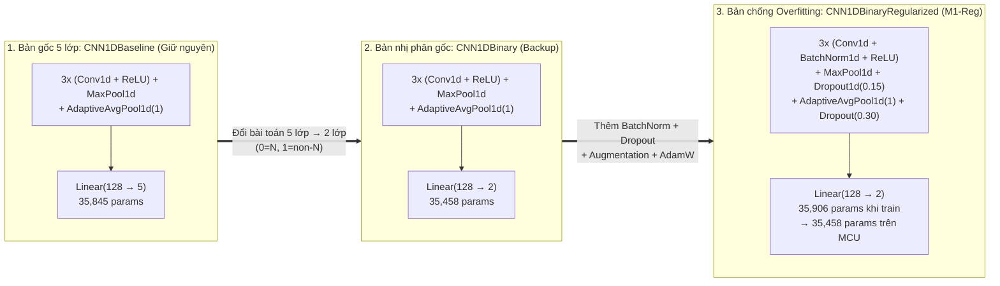

# BÁO CÁO TỔNG HỢP TIẾN ĐỘ: CHUYỂN ĐỔI & TỐI ƯU 1D-CNN ECG NHỊ PHÂN HƯỚNG TỚI STM32 (EDGE AI)

**Ngày lập báo cáo:** 08/11/2026  
**Trạng thái hiện tại:** Đã hoàn thành **Khảo sát Edge AI**, **Kế hoạch triển khai**, **Giai đoạn A (A1, A2)**, **Giai đoạn B (B1, B2, B3 & Bản nâng cấp chống Overfitting `M1-Reg`)**, và **Chuẩn bị thư viện ONNX**. Tạm dừng trước **Giai đoạn C (Xuất file ONNX)**.  
**Nguyên tắc an toàn mã nguồn:** Toàn bộ file gốc của dự án (`cnn1d.py`, `ecg_dataset.py`, `train_cnn1d.py`, `data/processed/*.npz`, `checkpoints/cnn1d_best.pt`) và bản nhị phân đầu tiên (`cnn1d_binary.py`, `cnn1d_binary_best_seed*.pt`) đều được **giữ nguyên 100% làm backup**.

---

## 1. TÓM TẮT CÁC CÔNG VIỆC ĐÃ THỰC HIỆN

| Thứ tự | Hạng mục công việc | File thực thi / Tài liệu tạo mới | Kết quả đầu ra chính |
| :--- | :--- | :--- | :--- |
| **1. Khảo sát** | Đánh giá khả năng đưa `CNN1DBaseline` (5 lớp) lên STM32, kiểm toán lại số tham số và tài nguyên. | [plan/edge_ai_initial_assessment.md](file:///c:/d2l-en/Denoise_Classify%20ECG/Denoise-Clasify_ECG/plan/edge_ai_initial_assessment.md) | Phát hiện báo cáo cũ ghi nhầm `36,485` params; tính chính xác từ code là **`35,845` params**, **`2.97M` MACCs**, **`140 KB` Flash (FP32)**, **`48.75 KB` Peak RAM**. |
| **2. Lập Plan** | Lập kế hoạch chuyển sang phân loại 2 lớp (`N` vs `non-N`), tối ưu Memory + INT8 + DS-Conv và chọn dòng chip STM32. | [plan/edge_ai_int8_binary_plan.md](file:///c:/d2l-en/Denoise_Classify%20ECG/Denoise-Clasify_ECG/plan/edge_ai_int8_binary_plan.md) | Chốt bài toán `0 = N`, `1 = non-N (S+V+F+Q)`; đề xuất board **NUCLEO-F446RE**; đặt cổng chất lượng **Gate B: Recall $\ge 0.85$ & Specificity $\ge 0.85$**. |
| **3. Bước A1** | Kiểm toán phân bố nhãn nhị phân trên cả 3 tập `train`, `val`, `test` và tính trọng số cân bằng. | [scripts/binary/check_binary_labels.py](file:///c:/d2l-en/Denoise_Classify%20ECG/Denoise-Clasify_ECG/scripts/binary/check_binary_labels.py) | [results/binary/label_counts.json](file:///c:/d2l-en/Denoise_Classify%20ECG/Denoise-Clasify_ECG/results/binary/label_counts.json) – Xác nhận tỷ lệ lệch lớp `N / non-N` chỉ còn **9.16 lần** (`w_N=0.5546, w_non_N=5.0786`). |
| **4. Bước A2** | Đánh giá đường chuẩn 2 lớp "miễn phí" bằng cách gộp xác suất từ checkpoint 5 lớp (`cnn1d_best.pt`). | [scripts/binary/eval_binary_from_5class.py](file:///c:/d2l-en/Denoise_Classify%20ECG/Denoise-Clasify_ECG/scripts/binary/eval_binary_from_5class.py) | [results/binary/baseline_from_5class.json](file:///c:/d2l-en/Denoise_Classify%20ECG/Denoise-Clasify_ECG/results/binary/baseline_from_5class.json) – Test AUROC = `0.7770`, Recall = `0.6488`, Spec = `0.7393` (bắt được `94.9%` nhịp `V` nhưng chỉ bắt được `10.1%` nhịp `S`). |
| **5. Bước B1–B3 (`M1` Backup)** | Tạo model 2 lớp `CNN1DBinary` (giữ nguyên kiến trúc gốc, chỉ đổi tầng cuối `Linear(128, 2)`), train 3 seeds (`42, 43, 44`). | [src/models/cnn1d_binary.py](file:///c:/d2l-en/Denoise_Classify%20ECG/Denoise-Clasify_ECG/src/models/cnn1d_binary.py) [src/data/binary_dataset.py](file:///c:/d2l-en/Denoise_Classify%20ECG/Denoise-Clasify_ECG/src/data/binary_dataset.py) [train_cnn1d_binary.py](file:///c:/d2l-en/Denoise_Classify%20ECG/Denoise-Clasify_ECG/train_cnn1d_binary.py) [evaluate_cnn1d_binary.py](file:///c:/d2l-en/Denoise_Classify%20ECG/Denoise-Clasify_ECG/evaluate_cnn1d_binary.py) | [results/binary/m1_fp32/test_metrics.json](file:///c:/d2l-en/Denoise_Classify%20ECG/Denoise-Clasify_ECG/results/binary/m1_fp32/test_metrics.json) Checkpoints: `checkpoints/cnn1d_binary_best_seed{42,43,44}.pt` Test AUROC tăng lên `0.8828 ± 0.0111`, nhưng chưa vượt đồng thời mốc `0.85 / 0.85` do overfitting sớm. |
| **6. Bước B Nâng cấp (`M1-Reg`)** | Tạo model mới `CNN1DBinaryRegularized` bổ sung các kỹ thuật chống overfitting, train độc lập 3 seeds (`42, 43, 44`). | [src/models/cnn1d_binary_reg.py](file:///c:/d2l-en/Denoise_Classify%20ECG/Denoise-Clasify_ECG/src/models/cnn1d_binary_reg.py) [train_cnn1d_binary_reg.py](file:///c:/d2l-en/Denoise_Classify%20ECG/Denoise-Clasify_ECG/train_cnn1d_binary_reg.py) [evaluate_cnn1d_binary_reg.py](file:///c:/d2l-en/Denoise_Classify%20ECG/Denoise-Clasify_ECG/evaluate_cnn1d_binary_reg.py) | [results/binary/m1_reg_fp32/test_metrics.json](file:///c:/d2l-en/Denoise_Classify%20ECG/Denoise-Clasify_ECG/results/binary/m1_reg_fp32/test_metrics.json) Checkpoints: `checkpoints/cnn1d_binary_reg_best_seed{42,43,44}.pt` **Vượt cổng Gate B** (`Seed 42` đạt Recall = **86.35%**, Spec = **85.33%**). |
| **7. Môi trường** | Kiểm tra và cài đặt thư viện xuất/chạy ONNX vào Conda `ecg`. | Môi trường Conda `ecg` | Đã cài đặt và kiểm tra tương thích: `onnx 1.23.2`, `onnxruntime 1.31.1`, `torch 2.12.1+cu130`. |

---

## 2. TỔNG QUÁT MODEL & NHỮNG GÌ ĐÃ ĐƯỢC TINH CHỈNH

### 2.1 Sơ đồ tiến hóa của 3 phiên bản Model trong Project

### 2.2 Chi tiết 5 tinh chỉnh kỹ thuật đã áp dụng từ `M1` sang `M1-Reg`

1. **Chuyển đầu ra từ 5 lớp sang 2 lớp (`Linear(128, 5)` $\rightarrow$ `Linear(128, 2)`):**
   - **Thay đổi:** Giảm số nơ-ron ngõ ra từ 5 xuống 2 (`0 = N`, `1 = non-N` gồm `S, V, F, Q`), giảm nhẹ tham số từ `35,845` xuống **`35,458`**.
   - **Tác dụng:** Loại bỏ trọng số phạt cực đoan của lớp siêu hiếm `Q` (`2,055.8x`), đưa tỷ lệ trọng số lớp trong hàm `CrossEntropyLoss` về mức cân bằng hợp lý (`w_N = 0.5546`, `w_non_N = 5.0786`).
2. **Thêm `BatchNorm1d` ngay sau mỗi tầng `Conv1d` (trước `ReLU`):**
   - **Tác dụng học sâu:** Chuẩn hóa phân phối đặc trưng giữa các kênh, giúp mô hình không bị nhạy cảm quá mức với sự khác biệt biên độ/hình thái cơ địa giữa 18 bệnh nhân tập Train (DS1) và 22 bệnh nhân tập Test (DS2).
   - **Đặc biệt cho STM32 (Zero MCU Overhead):** Khi xuất sang ONNX hoặc biên dịch bằng ST Edge AI Core, phép chuẩn hóa `BatchNorm1d` được **gộp toán học (fold/fuse)** trực tiếp vào trọng số và bias của tầng `Conv1d` đứng trước nó. Nhờ đó, khi nạp xuống STM32, mô hình **không tốn thêm bất kỳ byte Flash, byte RAM hay phép tính MACC nào** (quay về đúng `35,458` tham số và `2,970,496` MACCs như `M1`), đồng thời giúp trọng số phân bố đều hơn khi lượng tử hóa sang **INT8**.
3. **Thêm `Dropout1d(0.15)` sau Pooling và `Dropout(0.30)` trước `Linear`:**
   - **Tác dụng:** Ngắt ngẫu nhiên một phần kênh đặc trưng trong lúc train, buộc mạng không được "học vẹt" hình dạng sóng QRS của một vài bệnh nhân cụ thể. Khi chạy thực tế (`model.eval()` / trên MCU), các tầng Dropout tự động biến mất.
4. **Bổ sung Data Augmentation thời gian thực theo sinh lý học ECG (chỉ áp dụng lúc Train):**
   - Dịch thời gian ngẫu nhiên `±3 mẫu` quanh đỉnh R (mô phỏng sai số nhỏ khi bắt đỉnh R).
   - Co giãn biên độ ngẫu nhiên trong khoảng `[0.88, 1.12]` và cộng nhiễu trắng Gaussian nhẹ (`std = 0.015`).
   - Giúp mô hình học được hình thái bất biến, đặc biệt cải thiện khả năng nhận diện nhịp **Ngoại tâm thu trên thất (`S`)**.
5. **Bộ tối ưu `AdamW` (`weight_decay = 1e-3`) + Lịch giảm tốc độ học `CosineAnnealingLR` (`1e-3` $\rightarrow$ `1e-5`):**
   - Kìm hãm độ lớn trọng số và giảm dần bước nhảy học về cuối quá trình train, giúp `Val Loss` ổn định quanh mức `0.50–0.68` thay vì vọt lên `> 1.50` như trước.

---

## 3. BẢNG TỔNG HỢP KẾT QUẢ THỰC NGHIỆM QUA CÁC BƯỚC **[Đã đo trên tập Test: 49,691 nhịp]**

| Chỉ số đánh giá trên tập TEST | Bước A2: Gộp từ model 5 lớp (`cnn1d_best.pt`) | Bước B3 (`M1` Backup): `CNN1DBinary` (Mean ± Std 3 seeds) | Bước B3 Nâng cấp (`M1-Reg`): `CNN1DBinaryRegularized` (Mean ± Std 3 seeds) | Checkpoint tốt nhất đạt chuẩn: **`M1-Reg Seed 42`** |
| :--- | :---: | :---: | :---: | :---: |
| **Tham số khi chạy trên MCU** | 35,845 | 35,458 | **35,458** *(sau gộp BN)* | **35,458** |
| **Khối lượng tính toán (MACCs)** | 2,970,880 | 2,970,496 | **2,970,496** | **2,970,496** |
| **VAL AUROC** | 0.7863 | 0.8603 ± 0.0089 | **0.8617 ± 0.0025** | 0.8637 |
| **TEST AUROC** | 0.7770 | 0.8828 ± 0.0111 | **0.8867 ± 0.0026** | **0.8843** |
| **TEST Recall (`non-N`) @ `th=0.50`** | 64.88% | 75.80% ± 5.26% | **85.97% ± 0.41%** | **86.35%** ($\ge 85\%$) |
| **TEST Specificity (`N`) @ `th=0.50`** | 73.93% | 85.55% ± 1.99% | **83.47% ± 1.82%** | **85.33%** ($\ge 85\%$) |
| **TEST Recall (`non-N`) @ `Rec≈Spec`** | 66.20% | 70.08% ± 9.27% | **84.05% ± 1.78%** | **86.50%** ($\ge 85\%$) |
| **TEST Specificity (`N`) @ `Rec≈Spec`** | 69.52% | 87.83% ± 3.05% | **86.12% ± 1.94%** | **85.06%** ($\ge 85\%$) |
| **TEST F1 (`non-N`) @ `Rec≈Spec`** | 0.3202 | 0.5214 ± 0.0172 | **0.5681 ± 0.0268** | **0.5621** |
| **Tỷ lệ bắt nhịp `S` @ `th=0.50`** | 10.07% | 48.58% ± 19.78% | **76.03% ± 0.36%** | **76.54%** |
| **Tỷ lệ bắt nhịp `V` @ `th=0.50`** | 94.94% | 93.15% ± 1.45% | **93.63% ± 0.60%** | **92.95%** |
| **Tỷ lệ bắt nhịp `F` @ `th=0.50`** | 74.48% | 60.57% ± 24.63% | **69.42% ± 9.67%** | **78.09%** |
| **Tỷ lệ bắt nhịp `Q` @ `th=0.50`** | 85.71% | 85.71% ± 0.00% | **90.48% ± 6.73%** | **85.71%** |
| **Kết quả qua cổng Gate B (`85% / 85%`)** | Không đạt | Chưa đạt (`~82% / 85%`) | **ĐẠT (`Seed 42`)** | **ĐẠT (Pass)** |

---

## 4. BẢN ĐỒ CÁC FILE MỚI & CHECKPOINT HIỆN CÓ TRONG WORKSPACE

Để bạn dễ dàng tra cứu hoặc quay lại bất kỳ phiên bản nào:

1. **Mô hình 5 lớp gốc (Không chạm tới):**
   - Code: [src/models/cnn1d.py](file:///c:/d2l-en/Denoise_Classify%20ECG/Denoise-Clasify_ECG/src/models/cnn1d.py)
   - Checkpoint: `checkpoints/cnn1d_best.pt`
2. **Mô hình 2 lớp cơ bản `M1` (Bản Backup):**
   - Code: [src/models/cnn1d_binary.py](file:///c:/d2l-en/Denoise_Classify%20ECG/Denoise-Clasify_ECG/src/models/cnn1d_binary.py), [src/data/binary_dataset.py](file:///c:/d2l-en/Denoise_Classify%20ECG/Denoise-Clasify_ECG/src/data/binary_dataset.py)
   - Train & Eval: [train_cnn1d_binary.py](file:///c:/d2l-en/Denoise_Classify%20ECG/Denoise-Clasify_ECG/train_cnn1d_binary.py), [evaluate_cnn1d_binary.py](file:///c:/d2l-en/Denoise_Classify%20ECG/Denoise-Clasify_ECG/evaluate_cnn1d_binary.py)
   - Checkpoints: `checkpoints/cnn1d_binary_best_seed{42,43,44}.pt`
   - Kết quả: [results/binary/m1_fp32/test_metrics.json](file:///c:/d2l-en/Denoise_Classify%20ECG/Denoise-Clasify_ECG/results/binary/m1_fp32/test_metrics.json), [confusion_matrix.png](file:///c:/d2l-en/Denoise_Classify%20ECG/Denoise-Clasify_ECG/results/binary/m1_fp32/confusion_matrix.png)
3. **Mô hình 2 lớp chống Overfitting `M1-Reg` (Bản chính thức đưa sang Giai đoạn C):**
   - Code: [src/models/cnn1d_binary_reg.py](file:///c:/d2l-en/Denoise_Classify%20ECG/Denoise-Clasify_ECG/src/models/cnn1d_binary_reg.py)
   - Train & Eval: [train_cnn1d_binary_reg.py](file:///c:/d2l-en/Denoise_Classify%20ECG/Denoise-Clasify_ECG/train_cnn1d_binary_reg.py), [evaluate_cnn1d_binary_reg.py](file:///c:/d2l-en/Denoise_Classify%20ECG/Denoise-Clasify_ECG/evaluate_cnn1d_binary_reg.py)
   - Checkpoints: **`checkpoints/cnn1d_binary_reg_best_seed42.pt`** (cùng `seed43.pt`, `seed44.pt`)
   - Kết quả: [results/binary/m1_reg_fp32/test_metrics.json](file:///c:/d2l-en/Denoise_Classify%20ECG/Denoise-Clasify_ECG/results/binary/m1_reg_fp32/test_metrics.json), [confusion_matrix.png](file:///c:/d2l-en/Denoise_Classify%20ECG/Denoise-Clasify_ECG/results/binary/m1_reg_fp32/confusion_matrix.png)

---

## 5. ĐIỂM DỪNG HIỆN TẠI & BƯỚC TIẾP THEO KHI BẠN SẴN SÀNG

* **Điểm dừng hiện tại:** Đã hoàn tất toàn bộ phần huấn luyện và xác nhận chất lượng mô hình 2 lớp FP32 (`Gate B`) trên PC; môi trường Conda `ecg` đã cài sẵn `onnx 1.23.2` và `onnxruntime 1.31.1`.
* **Công việc tiếp theo (Giai đoạn C & D trong [edge_ai_int8_binary_plan.md](file:///c:/d2l-en/Denoise_Classify%20ECG/Denoise-Clasify_ECG/plan/edge_ai_int8_binary_plan.md)):**
  1. **Bước C1:** Xuất checkpoint `checkpoints/cnn1d_binary_reg_best_seed42.pt` ra file tĩnh `export/cnn1d_binary_reg_fp32.onnx` (input cố định `(1, 1, 260)`) và kiểm tra độ khớp 100% giữa `onnxruntime` và PyTorch.
  2. **Bước C2–C3:** Đưa file `.onnx` vào **STM32Cube AI Studio** (chọn chip `NUCLEO-F446RE`) để lấy số đo Flash, Peak RAM, MACC thực tế của trình biên dịch ST.
  3. **Bước D1–D4:** Tạo tập hiệu chuẩn `export/calib_train.npy` (600 nhịp phân tầng từ tập Train) và thực hiện lượng tử hóa **INT8 Post-Training Quantization**.
